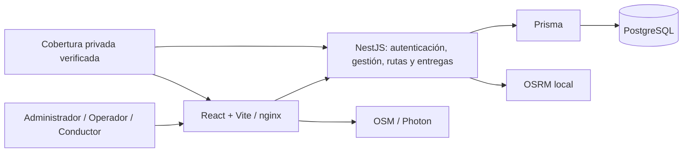

# DistriRapido · EcoRuta Huancayo

[](https://github.com/RicardoF1/DistriRapido/actions/workflows/ci.yml)
[](https://github.com/RicardoF1/DistriRapido/actions/workflows/tests.yml)
[](https://github.com/RicardoF1/DistriRapido/actions/workflows/deploy-production.yml)

Plataforma web para gestionar la distribución y las entregas de última milla en Huancayo. Proyecto del curso **Taller de Proyectos 2**.

Nombre académico: **Plataforma web con Algoritmo Genético para optimizar rutas sostenibles de última milla en Huancayo**. La línea base denomina al sistema EcoLogística Huancayo; la interfaz posterior usa EcoRuta Huancayo. El algoritmo genético y la PWA son objetivos del proyecto, no capacidades acreditadas por esta entrega.

## Tabla de contenido

- [Equipo](#equipo)
- [Problemática y PMV](#problemática-y-pmv)
- [Estado vigente e historia](#estado-vigente-e-historia)
- [Tecnologías y arquitectura](#tecnologías-y-arquitectura)
- [Instalación](#instalación)
- [Build](#build)
- [Despliegue](#despliegue)
- [Video explicativo](#video-explicativo)
- [Fase 01: Inicio del Proyecto](#fase-01-inicio-del-proyecto)
- [Fase 02: Planificación del Proyecto](#fase-02-planificación-del-proyecto)
- [Fase 03: Implementación del Proyecto](#fase-03-implementación-del-proyecto)
- [Versionamiento y evidencias](#versionamiento-y-evidencias)

## Equipo

Grupo G5228 de Taller de Proyectos 2. Integrantes según el cronograma de la Inspección 5 y [Artefactos Jira](docs/02%20Planificación/02%20Artefactos%20Jira%20V_1_0_0.md):

| Integrante | Rol en el proyecto | Responsabilidad principal en el Sprint 4 |
|---|---|---|
| Rupay Chira, Rosalyn Exkra | **Líder del proyecto (Scrum Master)** | Gestión del sprint en Jira, Revisión y Retrospectiva |
| Flores Toribio, Ricardo Miguel | Desarrollador (backend y frontend) | Implementación de US-018 a US-023 e integración en `main` |
| Janampa Navarro, Clinton | Desarrollador (DevOps y calidad) | Workflows de GitHub Actions (`tests.yml` y `deploy-production.yml`) y despliegue continuo |
| Albornoz Quiliano, José Antonio | Desarrollador (calidad y usabilidad) | Aplicación y análisis de la evaluación SUS |
| Veliz De La Cruz, Carlos Adrián | Desarrollador (calidad y usabilidad) | Aplicación y análisis de la evaluación SUS |

## Problemática y PMV

La distribución en Huancayo debe conciliar destinos, ventanas de entrega, capacidad de vehículos, disponibilidad de conductores y recorridos. La planificación manual dificulta coordinar estas restricciones y evaluar distancias, tiempos e impacto ambiental. Fuente: [Acta de Constitución](docs/01%20Inicio/02.%20Acta%20de%20Constitución%20V_1_0_0.md).

El PMV prioriza centralizar usuarios, pedidos, vehículos y conductores y permitir preparar, calcular, consultar y asignar recorridos y registrar entregas. Esta secuencia permite demostrar una operación básica antes de ampliar optimización y reportes. Es una justificación técnica basada en los incrementos existentes; **no acredita aprobación del PMV completo** del acta (que también contempla algoritmo genético, indicadores y reoptimización).

## Estado vigente e historia

Estado sobre `main` al cierre del Sprint 4 (2026-11-20). Repositorio público. Los tres workflows obligatorios (`ci.yml`, `tests.yml` y `deploy-production.yml`) están en verde y el sistema está desplegado en **https://distrirapido.onrender.com**. Los resultados de sprints anteriores enlazados son históricos.

| Incremento | Evidencia y límite |
|---|---|
| Sprint 1: US-001 a US-005 | Acceso, sesión, usuarios, registro y consulta de pedidos. Informes históricos V_1_0_0 conservados; aceptación formal y cierre requieren evidencia del equipo. |
| Sprint 2: US-006 a US-009 | Estados de pedidos, vehículos, conductores y disponibilidad integrados en PR #5–#7. Gestión V_1_1_0 preparada a partir de evidencia técnica; no se declara cierre. |
| Sprint 3: HGR-32 a HGR-36 | Consulta/comparación, asignación, panel del conductor y entregas. Los informes registran cierre administrativo en Jira y evidencia local de noviembre; esto no implica aceptación docente del producto completo. |
| Sprint 04 — entregables | Informes técnicos de US-018 a US-023, Revisión y Retrospectiva del Sprint y Análisis Playwright (E2E en Chromium, Firefox y WebKit, rendimiento y resiliencia). Evaluación de usabilidad SUS (n = 10, promedio 72,0) y despliegue continuo a producción en Render. [Ver entregables](#sprint-04--entregables). |
| Inspección 04 — Green IT | Entrega independiente de reducción del impacto ambiental y estándares; conserva resultados históricos y limitaciones de evidencia. |

La **interfaz sí permite asignar rutas**: [RouteAssignmentPanel](src/frontend/src/features/routes/RouteAssignmentPanel.tsx), integrado en [RouteDetailPage](src/frontend/src/pages/RouteDetailPage.tsx), con endpoint `PATCH /routes/:id/assignment`. Desde US-020 solo se asignan rutas confirmadas antes con `PATCH /routes/:id/confirmation`. La afirmación anterior de interfaz pendiente describía el estado previo al commit `7745ef3`.

El cálculo documentado usa OSRM sobre un orden confirmado (`SECUENCIAL_OSRM`, `optimized=false`); no demuestra optimización genética global ni tráfico en tiempo real. La deuda de reprogramación de pedidos NO_ENTREGADA se registra como HGR-43. La PWA, la conformidad WCAG completa y la aceptación del PMV siguen pendientes. Los informes de cada fase conservan el alcance que tenían entonces.

## Tecnologías y arquitectura

| Capa | Tecnologías verificadas |
|---|---|
| Interfaz | React 19, TypeScript, Vite 7, React Router, TanStack Query, Leaflet |
| API | NestJS 11 sobre Node.js 24, JWT/cookie HttpOnly, Argon2id |
| Persistencia | Prisma 6.12 y PostgreSQL 16 |
| Geografía | Política común en `geodata/coverage.ts`, cobertura privada INEI, teselas OpenStreetMap y geocodificación Photon |
| Rutas | OSRM local; [aprovisionamiento](infra/osrm/README.md) |
| Empaquetado y calidad | Docker Compose, nginx, GitHub Actions, Jest, Vitest, Playwright, SonarQube, Lighthouse |

NestJS/Prisma/PostgreSQL conserva validación, módulos y persistencia relacional para entidades y restricciones logísticas. Es la adaptación técnica del enunciado MERN, documentada en [Green IT](docs/03%20Implementación/reduccion%20del%20impacto%20ambiental/01%20Informe%20de%20reduccion%20del%20impacto%20ambiental%20V_1_0_0.md). La adaptación del stack se presentó al docente en las inspecciones de los Sprints 3 y 4.



La autorización y la cobertura se validan también en servidor. Consulta el [C4 histórico V_1_1_0](docs/01%20Inicio/12.%20Modelo%20C4%20V_1_1_0.md), el [diseño de rutas](docs/otros/superpowers/specs/2026-10-29-routing-osrm-design.md) y los README de [backend](src/backend/README.md), [frontend](src/frontend/README.md) y [geodata](geodata/README.md).

## Instalación

Procedimiento para un entorno propio autorizado; los comandos de esta sección **no se ejecutaron durante la revisión documental**.

1. Instalar Git, Node.js 24/npm y, para el despliegue local completo, Docker con Compose.
2. Clonar el repositorio y entrar en la raíz.
3. Configurar un archivo local `.env` o variables de sesión con secretos propios. **No existe `.env.example` versionado en este commit**; no copiar supuestas credenciales de los informes históricos.
4. Solicitar por un canal privado el paquete de cobertura aprobado. Sin él, el build con npm puede compilar, pero no se puede registrar un destino operativo; los Dockerfiles requieren el paquete. No usar fixtures sintéticos como datos de producción.
5. Instalar dependencias por aplicación:

```sh
npm --prefix src/backend ci
npm --prefix src/backend run prisma:generate
npm --prefix src/frontend ci
```

| Variable | Uso |
|---|---|
| `POSTGRES_USER`, `POSTGRES_PASSWORD`, `POSTGRES_DB`, `POSTGRES_PORT` | Compose; puerto de host por defecto 5432 (no asumir el 5433 histórico) |
| `DATABASE_URL` | API ejecutada con npm; apuntar solo a la base autorizada |
| `JWT_SECRET`, `JWT_EXPIRES_IN` | Firma y duración de sesión; secreto propio |
| `FRONTEND_ORIGIN` | Origen autorizado, habitualmente `http://localhost:5173` |
| `VITE_API_URL` | URL pública de API; habitualmente `http://localhost:3000` |
| `OSRM_BASE_URL`, `OSRM_ALLOWED_ORIGIN`, `OSRM_DATA_REVISION` | Servicio y revisión del grafo; consultar su README |

Aprovisionar y comprobar el paquete autorizado desde la raíz:

```sh
node scripts/provision-coverage.cjs --source "/directorio/privado/autorizado/v1"
node scripts/provision-coverage.cjs
```

La inicialización del esquema y el bootstrap **son pasos separados que necesitan revisión de destino y autorización**; no forman parte del arranque ordinario. Los procedimientos están en el [backend](src/backend/README.md) y [Compose de mantenimiento](docker-compose.migrations.yml). No ejecutar migraciones sobre una base existente como efecto secundario de leer esta guía.

Con base ya preparada y configuración válida, abrir dos terminales:

```sh
npm --prefix src/backend run start:dev
npm --prefix src/frontend run dev
```

Interfaz: `http://localhost:5173`; API: `http://localhost:3000`; Swagger: `http://localhost:3000/api/docs`.

## Build

Desde la raíz, con dependencias instaladas:

```sh
npm --prefix src/backend run build
npm --prefix src/frontend run build
```

Salidas: `src/backend/dist` y `src/frontend/dist`. Estos comandos no sustituyen validaciones funcionales ni aceptación de historias.

## Despliegue

El procedimiento disponible es **local con Docker Compose**, no una publicación productiva acreditada. Con secretos configurados, cobertura autorizada y esquema previamente preparado:

```sh
docker compose build backend frontend
docker compose up -d postgres backend frontend
```

El arranque de API usa `node dist/main.js` y no aplica migraciones automáticamente. OSRM requiere el [overlay y recursos descritos en su guía](infra/osrm/README.md); no se aprovisiona automáticamente con esos comandos. En producción se deben configurar HTTPS, orígenes reales, política de seguridad y operación de datos; la aprobación de ese despliegue está pendiente.

INEI se ofrece con referencia provisional a límites 2023; los metadatos internos de 2026 no prueban vigencia administrativa. La licencia de redistribución sigue pendiente: no publicar el paquete geográfico ni imágenes Docker que lo contengan. [Política y comprobaciones](geodata/README.md).

## Video explicativo

El video del proyecto (≈ 5 minutos: elevator pitch de 1 minuto y demostración técnica de 4 minutos, en `.mp4`) es un entregable de la evaluación final de la Semana 16 y se alojará en `docs/05 Video proyecto/`, según la consigna de cierre del proyecto. Para la Inspección 5, la demostración se realiza en vivo sobre el entorno de producción.

## Fase 01: Inicio del Proyecto

Se conservan los trece tipos de documento, sus nombres y sus versiones. Las fuentes oficiales de Drive siguen sin poder consultarse; no se ha demostrado una diferencia de nomenclatura que justifique renombrarlos.

| Tipo de documento | Referencia documental vigente* | Antecedentes |
|---|---|---|
| 01. Selección del enfoque del proyecto | [V_1_0_0](docs/01%20Inicio/01.%20Selecci%C3%B3n%20del%20enfoque%20del%20proyecto%20V_1_0_0.md) | Sin versión anterior adicional |
| 02. Acta de Constitución | [V_1_0_0](docs/01%20Inicio/02.%20Acta%20de%20Constituci%C3%B3n%20V_1_0_0.md) | Sin versión anterior adicional |
| 03. Declaración de la visión | [V_1_0_0](docs/01%20Inicio/03.%20Declaraci%C3%B3n%20de%20la%20visi%C3%B3n%20V_1_0_0.md) | Sin versión anterior adicional |
| 04. Registro de supuestos y restricciones | [V_1_0_0](docs/01%20Inicio/04.%20Registro%20de%20supuestos%20y%20restricciones%20V_1_0_0.md) | Sin versión anterior adicional |
| 05. Registro de interesados | [V_1_0_0](docs/01%20Inicio/05.%20Registro%20de%20interesados%20V_1_0_0.md) | Sin versión anterior adicional |
| 06. Requisitos funcionales | [V_1_2_0](docs/01%20Inicio/06.%20Requisitos%20funcionales%20V_1_2_0.md) | [V_1_1_0](docs/01%20Inicio/06.%20Requisitos%20funcionales%20V_1_1_0.md) · [V_1_0_0](docs/01%20Inicio/06.%20Requisitos%20funcionales%20V_1_0_0.md) |
| 07. Requisitos no funcionales | [V_1_0_0](docs/01%20Inicio/07.%20Requisitos%20no%20funcionales%20V_1_0_0.md) | Sin versión anterior adicional |
| 08. Usuarios | [V_1_0_0](docs/01%20Inicio/08.%20Usuarios%20V_1_0_0.md) | Sin versión anterior adicional |
| 09. Reglas de negocio | [V_1_2_0](docs/01%20Inicio/09.%20Reglas%20de%20negocio%20V_1_2_0.md) | [V_1_1_0](docs/01%20Inicio/09.%20Reglas%20de%20negocio%20V_1_1_0.md) · [V_1_0_0](docs/01%20Inicio/09.%20Reglas%20de%20negocio%20V_1_0_0.md) |
| 10. Stack tecnológico | [V_1_2_0](docs/01%20Inicio/10.%20Stack%20tecnol%C3%B3gico%20V_1_2_0.md) | [V_1_1_0](docs/01%20Inicio/10.%20Stack%20tecnol%C3%B3gico%20V_1_1_0.md) · [V_1_0_0](docs/01%20Inicio/10.%20Stack%20tecnol%C3%B3gico%20V_1_0_0.md) |
| 11. Base de datos | [V_1_2_0](docs/01%20Inicio/11.%20Base%20de%20datos%20V_1_2_0.md) | [V_1_1_0](docs/01%20Inicio/11.%20Base%20de%20datos%20V_1_1_0.md) · [V_1_0_0](docs/01%20Inicio/11.%20Base%20de%20datos%20V_1_0_0.md) |
| 12. Modelo C4 | [V_1_2_0](docs/01%20Inicio/12.%20Modelo%20C4%20V_1_2_0.md) | [V_1_1_0](docs/01%20Inicio/12.%20Modelo%20C4%20V_1_1_0.md) · [V_1_0_0](docs/01%20Inicio/12.%20Modelo%20C4%20V_1_0_0.md) |
| 13. Restricciones | [V_1_1_0](docs/01%20Inicio/13.%20Restricciones%20V_1_1_0.md) | [V_1_0_0](docs/01%20Inicio/13.%20Restricciones%20V_1_0_0.md) |

*Referencia vigente dentro de la serie documental disponible; no implica aceptación humana ni vigencia de todas sus afirmaciones sobre el software actual. Se conserva cada versión anterior.

## Fase 02: Planificación del Proyecto

Los cuatro informes permanecen directamente en `docs/02 Planificación/`, con sus versiones y las cinco capturas originales de Jira:

- [01 Transformando a ágil V_1_0_0](docs/02%20Planificaci%C3%B3n/01%20Transformando%20a%20%C3%A1gil%20V_1_0_0.md)
- [02 Artefactos Jira V_1_0_0](docs/02%20Planificaci%C3%B3n/02%20Artefactos%20Jira%20V_1_0_0.md)
- [03 Registro de riesgos V_1_0_0](docs/02%20Planificaci%C3%B3n/03%20Registro%20de%20riesgos%20V_1_0_0.md)
- [04 Presupuesto del proyecto V_1_0_0](docs/02%20Planificaci%C3%B3n/04%20Presupuesto%20del%20proyecto%20V_1_0_0.md)

## Fase 03: Implementación del Proyecto

Las carpetas **Sprint 01** y **Sprint 02** responden a una decisión expresa de organización del usuario; no se presentan como una exigencia literal de sus consignas. Se mantienen las versiones reales y la evidencia histórica, sin duplicar entregables.

### Sprint 01

Cuatro informes históricos del Sprint 1 (US-001–US-005), V_1_0_0. La aceptación formal y el cierre conservan sus pendientes.

- [01 Informe de estado del proyecto V_1_0_0](docs/03%20Implementaci%C3%B3n/Sprint%2001/01%20Informe%20de%20estado%20del%20proyecto%20V_1_0_0.md)
- [02 Registro de Impedimentos V_1_0_0](docs/03%20Implementaci%C3%B3n/Sprint%2001/02%20Registro%20de%20Impedimentos%20V_1_0_0.md)
- [03 Revisión del Sprint V_1_0_0](docs/03%20Implementaci%C3%B3n/Sprint%2001/03%20Revisi%C3%B3n%20del%20Sprint%20V_1_0_0.md)
- [04 Retrospectiva del Sprint V_1_0_0](docs/03%20Implementaci%C3%B3n/Sprint%2001/04%20Retrospectiva%20del%20Sprint%20V_1_0_0.md)

Material auxiliar: [antecedentes técnicos](docs/otros/antecedentes-sprint-01/README.md) y [mejoras posteriores al Sprint 1 V_1_1_0](docs/otros/antecedentes-sprint-01/05%20Mejoras%20posteriores%20al%20Sprint%201%20V_1_1_0.md).

### Sprint 02

Cuatro informes V_1_1_0, preparados desde evidencias existentes. Las fechas efectivas, responsables, demostración y aceptación siguen pendientes de validación humana; no se declara terminado el sprint.

- [01 Informe de estado del proyecto V_1_1_0](docs/03%20Implementaci%C3%B3n/Sprint%2002/01%20Informe%20de%20estado%20del%20proyecto%20V_1_1_0.md)
- [02 Registro de Impedimentos V_1_1_0](docs/03%20Implementaci%C3%B3n/Sprint%2002/02%20Registro%20de%20Impedimentos%20V_1_1_0.md)
- [03 Revisión del Sprint V_1_1_0](docs/03%20Implementaci%C3%B3n/Sprint%2002/03%20Revisi%C3%B3n%20del%20Sprint%20V_1_1_0.md)
- [04 Retrospectiva del Sprint V_1_1_0](docs/03%20Implementaci%C3%B3n/Sprint%2002/04%20Retrospectiva%20del%20Sprint%20V_1_1_0.md)

[Integración y resultados históricos de soporte](docs/otros/soporte-sprint-02/Integraci%C3%B3n%20Sprints%201%20y%202%20V_1_1_0.md).

### Sprint 03

Los cinco informes mantienen V_1_1_0 como versión posterior justificada; no se rebajan a V_1_0_0. Sus resultados de calidad, seguridad, accesibilidad y demostración corresponden a los commits y fechas que documentan.

- [01 Revisión del Sprint V_1_1_0](docs/03%20Implementaci%C3%B3n/Sprint%2003/01%20Revisi%C3%B3n%20del%20Sprint%20V_1_1_0.md)
- [02 Retrospectiva del Sprint V_1_1_0](docs/03%20Implementaci%C3%B3n/Sprint%2003/02%20Retrospectiva%20del%20Sprint%20V_1_1_0.md)
- [03 Calidad de código V_1_1_0](docs/03%20Implementaci%C3%B3n/Sprint%2003/03%20Calidad%20de%20c%C3%B3digo%20V_1_1_0.md)
- [04 OWASP V_1_1_0](docs/03%20Implementaci%C3%B3n/Sprint%2003/04%20OWASP%20V_1_1_0.md)
- [05 WCAG V_1_1_0](docs/03%20Implementaci%C3%B3n/Sprint%2003/05%20WCAG%20V_1_1_0.md)

[Evidencia técnica de soporte](docs/otros/soporte-sprint-03/06%20Evidencia%20t%C3%A9cnica%20de%20cierre%20del%20Sprint%203%20V_1_1_0.md) · [Inventario de capturas originales](docs/otros/soporte-sprint-03/evidencias/README.md).

### Sprint 04 — entregables

Entregables de cierre para la Inspección 5 (2026-11-20). Cada documento enlaza de vuelta a este README.

- [01 Revisión del Sprint V_1_0_0](docs/03%20Implementaci%C3%B3n/Sprint%2004/01%20Revisi%C3%B3n%20del%20Sprint%20V_1_0_0.md)
- [02 Retrospectiva del Sprint V_1_0_0](docs/03%20Implementaci%C3%B3n/Sprint%2004/02%20Retrospectiva%20del%20Sprint%20V_1_0_0.md)
- [03 Analisis PlayWrigth V_1_0_0](docs/03%20Implementaci%C3%B3n/Sprint%2004/03%20Analisis%20PlayWrigth%20V_1_0_0.md)
- [04 Usabilidad V_1_0_0](docs/03%20Implementaci%C3%B3n/Sprint%2004/04%20Usabilidad%20V_1_0_0.md) — SUS con n = 10: promedio 72,0, nota C+, «Bueno», cumple el umbral de 68. Material de aplicación: [Guía de aplicación SUS V_1_0_0](docs/otros/soporte-sprint-04/usabilidad/Gu%C3%ADa%20de%20aplicaci%C3%B3n%20SUS%20V_1_0_0.md).

Workflows de GitHub Actions: [ci.yml](.github/workflows/ci.yml) (typecheck, lint, pruebas, build, auditoría y CodeQL) · [tests.yml](.github/workflows/tests.yml) (backend, Vitest y E2E en Chromium, Firefox y WebKit, con el reporte HTML como artifact). [deploy-production.yml](.github/workflows/deploy-production.yml) (tras `tests.yml` en verde sobre `main`: imágenes en GHCR, migraciones, despliegue en Render y verificación de la URL pública). Configuración y operación: [Despliegue en Render V_1_0_0](docs/otros/despliegue/Despliegue%20en%20Render%20V_1_0_0.md).

Informes técnicos de las historias del sprint (material de soporte, fuera de la carpeta de entregables):

- [01 US-018 Registrar incidencias V_1_0_0](docs/otros/soporte-sprint-04/01%20US-018%20Registrar%20incidencias%20V_1_0_0.md)
- [02 US-019 Consultar estado operativo V_1_0_0](docs/otros/soporte-sprint-04/02%20US-019%20Consultar%20estado%20operativo%20V_1_0_0.md)
- [03 US-020 Confirmar ruta V_1_0_0](docs/otros/soporte-sprint-04/03%20US-020%20Confirmar%20ruta%20V_1_0_0.md)
- [04 US-021 Registrar sostenibilidad V_1_0_0](docs/otros/soporte-sprint-04/04%20US-021%20Registrar%20sostenibilidad%20V_1_0_0.md)
- [05 US-022 Consultar indicadores V_1_0_0](docs/otros/soporte-sprint-04/05%20US-022%20Consultar%20indicadores%20V_1_0_0.md)
- [06 US-023 Consultar historial V_1_0_0](docs/otros/soporte-sprint-04/06%20US-023%20Consultar%20historial%20V_1_0_0.md)

### Inspección 04 — Green IT

Entrega independiente del Sprint 04, en su carpeta exacta `reduccion del impacto ambiental/`, con sus evidencias originales:

- [01 Informe de reduccion del impacto ambiental V_1_0_0](docs/03%20Implementaci%C3%B3n/reduccion%20del%20impacto%20ambiental/01%20Informe%20de%20reduccion%20del%20impacto%20ambiental%20V_1_0_0.md)
- [02 Estandares Ingeniería de software V_1_0_0](docs/03%20Implementaci%C3%B3n/reduccion%20del%20impacto%20ambiental/02%20Estandares%20Ingenier%C3%ADa%20de%20software%20V_1_0_0.md)

Ocho optimizaciones documentadas con antes/después y estimación SWDM v4. Los resúmenes históricos muestran cumplimiento de los seis umbrales en escritorio; **móvil incumple FCP y LCP en las cuatro páginas y TBT en Registrar pedido**. Solo se encontraron cuatro informes HTML originales del login, además de los resúmenes JSON; faltan originales del resto. CI comprueba la fórmula SWDM, pero no recalcula emisiones con cada auditoría. No se acreditó un check obligatorio que bloquee merges. La aceptación docente de la adaptación del stack sigue pendiente.

[Índice documental y procedencia del material auxiliar](docs/README.md) · [Informe histórico de adecuación y pendientes](docs/otros/INFORME-EVALUACION-TP2.md).

Seguimiento y Control cuenta con evidencia parcial en informes de estado, impedimentos, Jira y calidad; su informe consolidado sigue pendiente. El video, la aceptación del PMV y el cierre global son requisitos generales del proyecto, no obligaciones atribuidas específicamente a Semana 13. Su validación continúa pendiente.

## Versionamiento y evidencias

El historial muestra ramas por historia/actividad y PR hacia `main` o integración de sprint. Véase [flujo y candidatos a PMV](docs/otros/VERSIONAMIENTO-Y-EVIDENCIAS.md). No hay tags ni releases de GitHub en la consulta de esta revisión. `v1.0.0-MVP` UNRELEASED de Jira no es un tag Git.

El commit `33e7601` tiene evidencia histórica de pruebas, SonarQube y demostración local del Sprint 3; es una referencia técnica a evaluar, no una entrega PMV formalmente aceptada. La selección y publicación de `v1.0.0` quedan pendientes del equipo.

### Control de cambios del README

| Revisión documental | Fecha | Cambio |
|---|---|---|
| Adecuación TP2 | 2026-11-12 | Completa secciones de la guía; separa antecedentes de estado vigente; enlaza gestión Sprint 2 y ruta oficial Sprint 3; declara limitaciones. |
| Cierre Sprint 04 | 2026-11-18 | Badges de `ci.yml` y `tests.yml`; sección «Sprint 04 — entregables» con Revisión, Retrospectiva, Análisis Playwright e informes US-018 a US-021. |
| Despliegue | 2026-11-19 | Workflow `deploy-production.yml` y su badge; guía de despliegue en Render. |
| Usabilidad | 2026-11-19 | Enlace a «04 Usabilidad V_1_0_0» con el resultado SUS. |
| Cierre Inspección 5 | 2026-11-20 | Equipo completo con roles y líder; estado vigente al cierre del Sprint 4; Requisitos funcionales y Stack tecnológico en V_1_2_0; se retiran los marcadores pendientes. |

Los entregables del Sprint 4 siguen la «Consigna de evaluación: implementación, calidad, despliegue y cierre del Sprint 4» de Taller de Proyectos 2 (Inspección 5).
