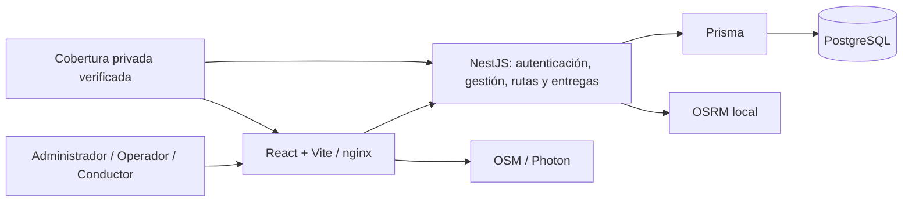

# DistriRapido · EcoRuta Huancayo

Plataforma web para gestionar la distribución y las entregas de última milla en Huancayo. Proyecto del curso **Taller de Proyectos 2**.

Nombre académico: **Plataforma web con Algoritmo Genético para optimizar rutas sostenibles de última milla en Huancayo**. La línea base denomina al sistema EcoLogística Huancayo; la interfaz posterior usa EcoRuta Huancayo. El algoritmo genético y la PWA son objetivos del proyecto, no capacidades acreditadas por esta entrega.

## Tabla de contenido

- [Equipo](#equipo)
- [Problemática y PMV](#problemática-y-pmv)
- [Estado vigente e historia](#estado-vigente-e-historia)
- [Tecnologías y arquitectura](#tecnologías-y-arquitectura)
- [Instalación](#instalación)
- [Build](#build)
- [Despliegue](#despliegue)
- [Video explicativo](#video-explicativo)
- [Fases y sprints](#fases-y-sprints)
- [Versionamiento y evidencias](#versionamiento-y-evidencias)

## Equipo

Integrantes según [Artefactos Jira](docs/02%20Planificación/02%20Artefactos%20Jira%20V_1_0_0.md):

| Integrante documentado |
|---|
| Flores, Toribio, Ricardo Miguel |
| Janampa, Navarro, Clinton |
| Rupay, Chira, Rosalyn Exkra |
| Veliz de la Cruz, Carlos Adrian |

Líder del proyecto y responsables de validación nominales: **Pendiente de aportar por el equipo**. Los autores de commits no sustituyen una asignación de roles.

## Problemática y PMV

La distribución en Huancayo debe conciliar destinos, ventanas de entrega, capacidad de vehículos, disponibilidad de conductores y recorridos. La planificación manual dificulta coordinar estas restricciones y evaluar distancias, tiempos e impacto ambiental. Fuente: [Acta de Constitución](docs/01%20Inicio/02.%20Acta%20de%20Constitución%20V_1_0_0.md).

El PMV prioriza centralizar usuarios, pedidos, vehículos y conductores y permitir preparar, calcular, consultar y asignar recorridos y registrar entregas. Esta secuencia permite demostrar una operación básica antes de ampliar optimización y reportes. Es una justificación técnica basada en los incrementos existentes; **no acredita aprobación del PMV completo** del acta (que también contempla algoritmo genético, indicadores y reoptimización).

## Estado vigente e historia

Inspección documental sobre `main`, commit `7cdde3b765aa4898ef61789640900bad4910d386`, el 2026-11-12. Repositorio público. Los resultados de pruebas y auditorías enlazados son históricos; en esta revisión solo se comprueba documentación.

| Incremento | Evidencia y límite |
|---|---|
| Sprint 1: US-001 a US-005 | Acceso, sesión, usuarios, registro y consulta de pedidos. Informes históricos V_1_0_0 conservados; aceptación formal y cierre requieren evidencia del equipo. |
| Sprint 2: US-006 a US-009 | Estados de pedidos, vehículos, conductores y disponibilidad integrados en PR #5–#7. Gestión V_1_1_0 preparada a partir de evidencia técnica; no se declara cierre. |
| Sprint 3: HGR-32 a HGR-36 | Consulta/comparación, asignación, panel del conductor y entregas. Los informes registran cierre administrativo en Jira y evidencia local de noviembre; esto no implica aceptación docente del producto completo. |
| Sprint 4 y Green IT | Existen informes técnicos de US-018, US-019 y optimizaciones. Su integración no acredita cierre del sprint. |

La **interfaz sí permite asignar rutas**: [RouteAssignmentPanel](src/frontend/src/features/routes/RouteAssignmentPanel.tsx), integrado en [RouteDetailPage](src/frontend/src/pages/RouteDetailPage.tsx), con endpoint `PATCH /routes/:id/assignment`. La afirmación anterior de interfaz pendiente describía el estado previo al commit `7745ef3`.

El cálculo documentado usa OSRM sobre un orden confirmado (`SECUENCIAL_OSRM`, `optimized=false`); no demuestra optimización genética global ni tráfico en tiempo real. La deuda de reprogramación de pedidos NO_ENTREGADA se registra como HGR-43. La PWA, la conformidad WCAG completa y la aceptación del PMV siguen pendientes. Los informes de cada fase conservan el alcance que tenían entonces.

## Tecnologías y arquitectura

| Capa | Tecnologías verificadas |
|---|---|
| Interfaz | React 19, TypeScript, Vite 7, React Router, TanStack Query, Leaflet |
| API | NestJS 11 sobre Node.js 24, JWT/cookie HttpOnly, Argon2id |
| Persistencia | Prisma 6.12 y PostgreSQL 16 |
| Geografía | Política común en `geodata/coverage.ts`, cobertura privada INEI, teselas OpenStreetMap y geocodificación Photon |
| Rutas | OSRM local; [aprovisionamiento](infra/osrm/README.md) |
| Empaquetado y calidad | Docker Compose, nginx, GitHub Actions, Jest, Vitest, Playwright, SonarQube, Lighthouse |

NestJS/Prisma/PostgreSQL conserva validación, módulos y persistencia relacional para entidades y restricciones logísticas. Es la adaptación técnica del enunciado MERN, documentada en [Green IT](docs/03%20Implementación/reduccion%20del%20impacto%20ambiental/01%20Informe%20de%20reduccion%20del%20impacto%20ambiental%20V_1_0_0.md). **Aceptación expresa del docente: Pendiente de aportar por el equipo.**



La autorización y la cobertura se validan también en servidor. Consulta el [C4 histórico V_1_1_0](docs/01%20Inicio/12.%20Modelo%20C4%20V_1_1_0.md), el [diseño de rutas](docs/otros/superpowers/specs/2026-10-29-routing-osrm-design.md) y los README de [backend](src/backend/README.md), [frontend](src/frontend/README.md) y [geodata](geodata/README.md).

## Instalación

Procedimiento para un entorno propio autorizado; los comandos de esta sección **no se ejecutaron durante la revisión documental**.

1. Instalar Git, Node.js 24/npm y, para el despliegue local completo, Docker con Compose.
2. Clonar el repositorio y entrar en la raíz.
3. Configurar un archivo local `.env` o variables de sesión con secretos propios. **No existe `.env.example` versionado en este commit**; no copiar supuestas credenciales de los informes históricos.
4. Solicitar por un canal privado el paquete de cobertura aprobado. Sin él, el build con npm puede compilar, pero no se puede registrar un destino operativo; los Dockerfiles requieren el paquete. No usar fixtures sintéticos como datos de producción.
5. Instalar dependencias por aplicación:

```sh
npm --prefix src/backend ci
npm --prefix src/backend run prisma:generate
npm --prefix src/frontend ci
```

| Variable | Uso |
|---|---|
| `POSTGRES_USER`, `POSTGRES_PASSWORD`, `POSTGRES_DB`, `POSTGRES_PORT` | Compose; puerto de host por defecto 5432 (no asumir el 5433 histórico) |
| `DATABASE_URL` | API ejecutada con npm; apuntar solo a la base autorizada |
| `JWT_SECRET`, `JWT_EXPIRES_IN` | Firma y duración de sesión; secreto propio |
| `FRONTEND_ORIGIN` | Origen autorizado, habitualmente `http://localhost:5173` |
| `VITE_API_URL` | URL pública de API; habitualmente `http://localhost:3000` |
| `OSRM_BASE_URL`, `OSRM_ALLOWED_ORIGIN`, `OSRM_DATA_REVISION` | Servicio y revisión del grafo; consultar su README |

Aprovisionar y comprobar el paquete autorizado desde la raíz:

```sh
node scripts/provision-coverage.cjs --source "/directorio/privado/autorizado/v1"
node scripts/provision-coverage.cjs
```

La inicialización del esquema y el bootstrap **son pasos separados que necesitan revisión de destino y autorización**; no forman parte del arranque ordinario. Los procedimientos están en el [backend](src/backend/README.md) y [Compose de mantenimiento](docker-compose.migrations.yml). No ejecutar migraciones sobre una base existente como efecto secundario de leer esta guía.

Con base ya preparada y configuración válida, abrir dos terminales:

```sh
npm --prefix src/backend run start:dev
npm --prefix src/frontend run dev
```

Interfaz: `http://localhost:5173`; API: `http://localhost:3000`; Swagger: `http://localhost:3000/api/docs`.

## Build

Desde la raíz, con dependencias instaladas:

```sh
npm --prefix src/backend run build
npm --prefix src/frontend run build
```

Salidas: `src/backend/dist` y `src/frontend/dist`. Estos comandos no sustituyen validaciones funcionales ni aceptación de historias.

## Despliegue

El procedimiento disponible es **local con Docker Compose**, no una publicación productiva acreditada. Con secretos configurados, cobertura autorizada y esquema previamente preparado:

```sh
docker compose build backend frontend
docker compose up -d postgres backend frontend
```

El arranque de API usa `node dist/main.js` y no aplica migraciones automáticamente. OSRM requiere el [overlay y recursos descritos en su guía](infra/osrm/README.md); no se aprovisiona automáticamente con esos comandos. En producción se deben configurar HTTPS, orígenes reales, política de seguridad y operación de datos; la aprobación de ese despliegue está pendiente.

INEI se ofrece con referencia provisional a límites 2023; los metadatos internos de 2026 no prueban vigencia administrativa. La licencia de redistribución sigue pendiente: no publicar el paquete geográfico ni imágenes Docker que lo contengan. [Política y comprobaciones](geodata/README.md).

## Video explicativo

Enlace al video de **máximo cinco minutos**: **Pendiente de aportar por el equipo**. Duración y acceso para el docente pendientes de comprobación.

## Fases y sprints

[Índice documental completo](docs/README.md) · [Informe de adecuación y pendientes](docs/otros/INFORME-EVALUACION-TP2.md).

| Fase | Documentación disponible y estado |
|---|---|
| 01 Inicio | [Acta](docs/01%20Inicio/02.%20Acta%20de%20Constitución%20V_1_0_0.md), [visión](docs/01%20Inicio/03.%20Declaración%20de%20la%20visión%20V_1_0_0.md) y [documentos de inicio](docs/01%20Inicio). V_1_1_0 complementa V_1_0_0 cuando existe. |
| 02 Planificación | [Transformación ágil](docs/02%20Planificación/01%20Transformando%20a%20ágil%20V_1_0_0.md), [Jira y cinco capturas](docs/02%20Planificación/02%20Artefactos%20Jira%20V_1_0_0.md), [riesgos](docs/02%20Planificación/03%20Registro%20de%20riesgos%20V_1_0_0.md), [presupuesto](docs/02%20Planificación/04%20Presupuesto%20del%20proyecto%20V_1_0_0.md). |
| 03 Implementación | Entregables por sprint a continuación; [evidencias técnicas](docs/03%20Implementación/evidencias-tecnicas). |
| 04 Seguimiento y Control | Evidencia parcial en informes de estado, impedimentos, Jira y calidad. No se encontró un informe específico consolidado de esta fase; pendiente de aportar/validar por el equipo. |
| 05 Cierre | Los informes de revisión y retrospectiva acreditan únicamente su sprint y alcance. Cierre global y aceptación del PMV: pendientes de aportar/validar por el equipo. |

### Sprint 1 — antecedentes V_1_0_0

- [01 Informe de estado](docs/03%20Implementación/01%20Informe%20de%20estado%20del%20proyecto%20V_1_0_0.md)
- [02 Registro de impedimentos](docs/03%20Implementación/02%20Registro%20de%20Impedimentos%20V_1_0_0.md)
- [03 Revisión](docs/03%20Implementación/03%20Revisión%20del%20Sprint%20V_1_0_0.md)
- [04 Retrospectiva](docs/03%20Implementación/04%20Retrospectiva%20del%20Sprint%20V_1_0_0.md)
- [Evidencias técnicas](docs/03%20Implementación/evidencias-tecnicas/Sprint-1/README.md) y [mejoras posteriores](docs/03%20Implementación/05%20Mejoras%20posteriores%20al%20Sprint%201%20V_1_1_0.md).

### Sprint 2 — gestión V_1_1_0

Los cuatro informes están directamente en `docs/03 Implementación/`; complementan y no reemplazan el historial del Sprint 1.

- [01 Informe de estado](docs/03%20Implementación/01%20Informe%20de%20estado%20del%20proyecto%20V_1_1_0.md)
- [02 Registro de impedimentos](docs/03%20Implementación/02%20Registro%20de%20Impedimentos%20V_1_1_0.md)
- [03 Revisión](docs/03%20Implementación/03%20Revisión%20del%20Sprint%20V_1_1_0.md)
- [04 Retrospectiva](docs/03%20Implementación/04%20Retrospectiva%20del%20Sprint%20V_1_1_0.md)
- [Integración y resultados históricos](docs/03%20Implementación/evidencias-tecnicas/Sprint-2/Integración%20Sprints%201%20y%202%20V_1_1_0.md).

### Sprint 3 — ruta oficial, versión posterior V_1_1_0

Se conserva la versión posterior existente; V_1_0_0 permanece en Git, sin duplicar ni rebajar los informes.

- [01 Revisión](docs/03%20Implementación/Sprint%2003/01%20Revisión%20del%20Sprint%20V_1_1_0.md)
- [02 Retrospectiva](docs/03%20Implementación/Sprint%2003/02%20Retrospectiva%20del%20Sprint%20V_1_1_0.md)
- [03 Calidad de código y SonarQube](docs/03%20Implementación/Sprint%2003/03%20Calidad%20de%20código%20V_1_1_0.md)
- [04 OWASP](docs/03%20Implementación/Sprint%2003/04%20OWASP%20V_1_1_0.md)
- [05 WCAG](docs/03%20Implementación/Sprint%2003/05%20WCAG%20V_1_1_0.md)
- [Evidencia técnica y capturas conservadas](docs/03%20Implementación/evidencias-tecnicas/Sprint-3/cierre/README.md).

### Green IT — Inspección 04

- [01 Informe de reducción del impacto ambiental](docs/03%20Implementación/reduccion%20del%20impacto%20ambiental/01%20Informe%20de%20reduccion%20del%20impacto%20ambiental%20V_1_0_0.md)
- [02 Estándares de ingeniería de software](docs/03%20Implementación/reduccion%20del%20impacto%20ambiental/02%20Estandares%20Ingeniería%20de%20software%20V_1_0_0.md)

Ocho optimizaciones documentadas con antes/después y estimación SWDM v4. Los resúmenes históricos muestran cumplimiento de los seis umbrales en escritorio; **móvil incumple FCP y LCP en las cuatro páginas y TBT en Registrar pedido**. Solo se encontraron cuatro informes HTML originales del login, además de los resúmenes JSON; faltan originales del resto. CI comprueba la fórmula SWDM, pero no recalcula emisiones con cada auditoría. No se acreditó un check obligatorio que bloquee merges.

## Versionamiento y evidencias

El historial muestra ramas por historia/actividad y PR hacia `main` o integración de sprint. Véase [flujo y candidatos a PMV](docs/otros/VERSIONAMIENTO-Y-EVIDENCIAS.md). No hay tags ni releases de GitHub en la consulta de esta revisión. `v1.0.0-MVP` UNRELEASED de Jira no es un tag Git.

El commit `33e7601` tiene evidencia histórica de pruebas, SonarQube y demostración local del Sprint 3; es una referencia técnica a evaluar, no una entrega PMV formalmente aceptada. La selección y publicación de `v1.0.0` quedan pendientes del equipo.

### Control de cambios del README

| Revisión documental | Fecha | Cambio |
|---|---|---|
| Adecuación TP2 | 2026-11-12 | Completa secciones de la guía; separa antecedentes de estado vigente; enlaza gestión Sprint 2 y ruta oficial Sprint 3; declara limitaciones. |

Las seis referencias oficiales de Drive no pudieron consultarse en esta sesión. Los requisitos se aplican desde la transcripción proporcionada por el equipo; no se atribuyen otros requisitos a archivos no leídos.
