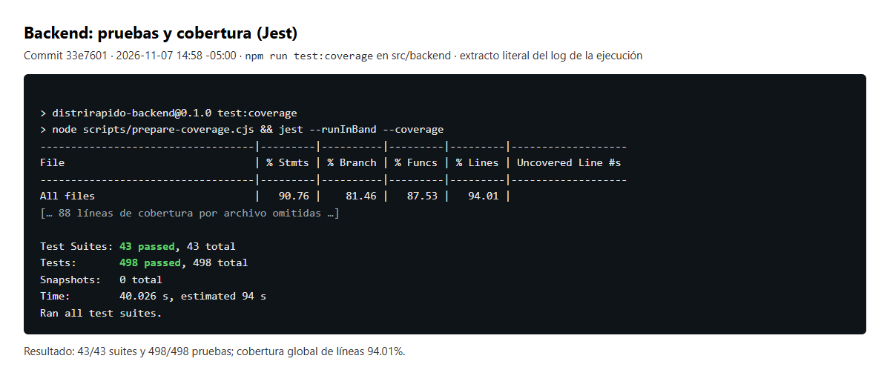
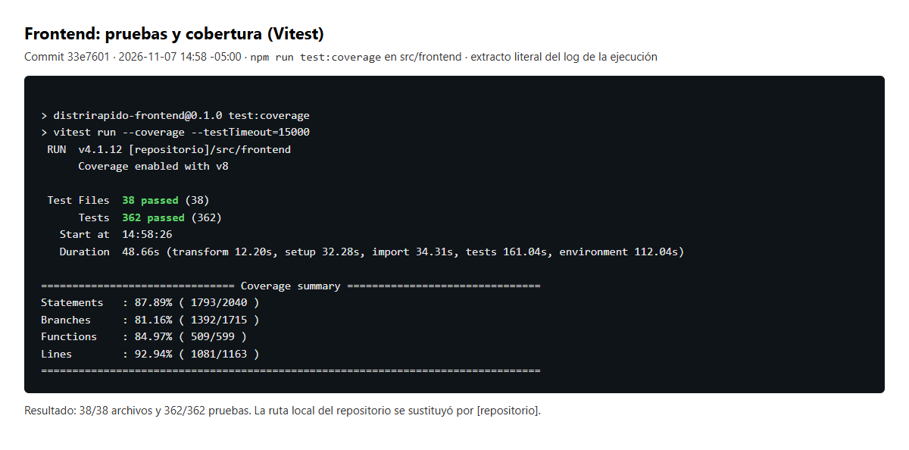
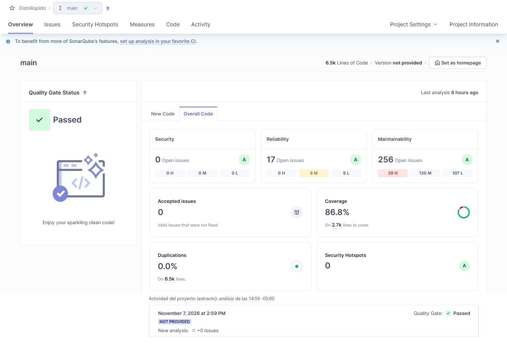

# 03 Calidad de código V_1_1_0

> Sprint 3 · Informe histórico V_1_1_0. Resultados sobre `33e7601` (noviembre de 2026), no sobre el HEAD actual. Traslado documental a la ruta oficial el 2026-11-12; no se repitieron pruebas, auditorías ni reuniones.

[Evidencia técnica conservada](../../otros/soporte-sprint-03/06%20Evidencia%20t%C3%A9cnica%20de%20cierre%20del%20Sprint%203%20V_1_1_0.md) · [Otros informes del Sprint 3](../../README.md#sprint-03)

## Identificación

- Versión del documento: V_1_1_0 (sustituye a V_1_0_0, disponible en el historial de Git)
- Fecha de actualización: 2026-11-07 -05:00
- Rama: main
- Commit final evaluado: 33e7601 (33e76018d3c656d1702d059765c518368d482234), 2026-11-07 14:57:19 -05:00
- Commit de integración original: debc2e7 (PR #12), 2026-10-30
- Validación funcional con OSRM local: 2026-11-06, commit 600564f
- Habilitación de la asignación desde la interfaz (HGR-34): 7745ef3, 2026-11-06 23:04:17 -05:00
- Análisis SonarQube final: análisis 9 sobre 33e7601, 2026-11-07 14:59:42 -05:00, Quality Gate OK
- Frontend desplegado localmente desde 33e7601: imagen sha256:98cfee35ba8a…, 2026-11-07 15:15:55 -05:00

## Resultados de pruebas (commit 33e7601)

| Módulo | Suites/archivos | Pruebas | Statements | Branches | Functions | Lines |
|---|---:|---:|---:|---:|---:|---:|
| Backend | 43/43 | 498/498 | 90.76% | 81.46% | 87.53% | 94.01% |
| Frontend | 38/38 | 362/362 | 87.89% | 81.16% | 84.97% | 92.94% |

*Figura 1. Backend: 43/43 suites y 498/498 pruebas con cobertura (Jest), commit `33e7601`, 2026-11-07 14:58 -05:00. Extracto del log real de la ejecución.*

*Figura 2. Frontend: 38/38 archivos y 362/362 pruebas con cobertura (Vitest, `--testTimeout=15000`), commit `33e7601`, 2026-11-07 14:58 -05:00. Extracto del log real; la ruta local del repositorio se sustituyó por [repositorio].*

- La cobertura frontend se ejecutó con `--testTimeout=15000`. No se modificaron los umbrales.
- La suite frontend completa se repitió 3 veces sin fallos y `DeliveryMap.test.tsx` 10 veces por separado sin fallos.
- Lint y typecheck sin errores en ambos módulos.
- E2E con API simulada y guarda de red contra la imagen del frontend de `33e7601`, la misma que quedó desplegada en local: 112/112.

## Controles aplicados

- ESLint en backend y frontend.
- TypeScript build sin errores.
- Pruebas unitarias y de componentes.
- Cobertura mínima global de ramas de 80%.
- git diff --check antes de commits de reconciliación.
- Prisma validate y migrate status.
- GitHub Actions para push y pull_request.
- CodeQL y code scanning.

## Hallazgos técnicos

- Vite advierte un chunk JavaScript superior a 500 KB.
- Algunas pruebas React emiten advertencias por actualizaciones no envueltas en act(...).
- El backend mantiene seis vulnerabilidades de severidad baja, transitivas de Jest (detalle en 09 Corrección de auditoría de dependencias V_1_1_0).
- No se aplicó npm audit fix --force para evitar cambios mayores no controlados.

## SonarQube

### Configuración del análisis

- Servidor: SonarQube 10.5.1 Community, ejecutado localmente.
- Proyecto: `distrirapido` (DistriRapido).
- Escáner: `sonarsource/sonar-scanner-cli` en Docker, con la revisión SCM igual al HEAD de main.
- Fuentes: `src/backend/src`, `src/frontend/src` y `src/frontend/coverage-assets.ts`.
- Pruebas: archivos `*.spec.ts`, `*.test.ts` y `*.test.tsx`.
- Exclusiones: `node_modules`, `dist`, reportes de cobertura, `src/backend/src/coverage/generated`, `geodata/coverage/v1` y `e2e`.
- Cobertura: LCOV de Jest y Vitest normalizado a rutas relativas a la raíz del repositorio. Todos los análisis registraron 0 rutas LCOV sin resolver.
- Quality Gate: `Sonar way`, con condiciones solo sobre código nuevo (`new_violations > 0`, `new_coverage < 80`, `new_duplicated_lines_density > 3`, `new_security_hotspots_reviewed < 100`). El periodo de código nuevo es `PREVIOUS_VERSION`.
- Los tokens de análisis y de lectura se usaron solo como variables de sesión y no se registran en esta evidencia.

### Historial de análisis

| Análisis | Commit | Fecha | Quality Gate | Observación |
|---|---|---|---|---|
| 1 | 9ea2146 | 2026-11-06 19:04:23 -05:00 | OK, sin condiciones evaluadas | Primer análisis del proyecto: al no existir una línea base, no había código nuevo y la API devolvió la lista de condiciones vacía. Este OK no equivale a una evaluación de calidad. |
| 2 | d2b632a | 2026-11-06 19:47:17 -05:00 | ERROR | Se evaluaron las condiciones: `new_violations` = 1, `new_coverage` = 97.6 % y `new_duplicated_lines_density` = 0.0 %. La violación fue S4624 (template literals anidados) en `planning-data.ts:39`. La línea de bloqueo ya existía, pero al cambiar su contenido y posición Sonar la registró como nueva. |
| 3 | 37bd746 | 2026-11-06 20:03:59 -05:00 | OK | Se evaluaron las condiciones: `new_violations` = 0, `new_coverage` = 100.0 % (20 líneas) y `new_duplicated_lines_density` = 0.0 %. |
| 4 | 29b5407 | 2026-11-07 01:41:28 -05:00 | ERROR | `new_violations` = 7 code smells introducidos por la interfaz de asignación (`7745ef3`); `new_coverage` = 96.6%. |
| 5 | 205ba24 | 2026-11-07 02:04:19 -05:00 | OK | Corrección de los 7 hallazgos: S3776 y S3358 en `RouteDetailPage`, S6819 con `<output>`, S1874 en `RouteAssignmentPanel`. |
| 6 | d66a5df | 2026-11-07 11:49:30 -05:00 | ERROR | `new_violations` = 5 code smells en `DriverAccessPage.tsx`, varios de ellos antiguos registrados como nuevos al modificar sus líneas. |
| 7 | ad1a963 | 2026-11-07 12:15:47 -05:00 | OK | Corrección de los 5 hallazgos del panel del conductor. |
| 8 | 935e8c3 | 2026-11-07 14:04:31 -05:00 | ERROR | `new_violations` = 1: S3358 (ternario anidado) en `AdminSummary.tsx`, existente desde 2026-10-09 y registrado como nuevo al reescribir la línea en la corrección de accesibilidad. |
| 9 | 33e7601 | 2026-11-07 14:59:42 -05:00 | OK | `new_violations` = 0, `new_coverage` = 96.3%, `new_duplicated_lines_density` = 0.0%. Análisis final del Sprint 3. |

### Métricas

| Métrica | Análisis 3 (37bd746) | Análisis 9 (33e7601), final |
|---|---:|---:|
| Coverage | 86.1% | 86.8% |
| Line coverage | 92.0% | 92.5% |
| Branch coverage | 80.5% | 81.3% |
| New coverage | 100.0% | 96.3% |
| Bugs | 0 | 0 |
| Vulnerabilities | 0 | 0 |
| Code smells | 263 | 256 |
| Security hotspots pendientes | 0 (3 revisados SAFE) | 0 (3 revisados SAFE) |
| New duplicated lines density | 0.0% | 0.0% |
| Technical debt | 1748 min | 1721 min (28 h 41 min) |
| NCLOC | 5850 | 6077 |
| Reliability / Security / Maintainability / Security review | A / A / A / A | A / A / A / A |

*Figura 3. SonarQube 10.5.1, resumen del proyecto tras el análisis 9 sobre `33e7601` (2026-11-07 14:59 -05:00): Quality Gate Passed, 0 issues de seguridad, cobertura 86.8%, duplicación 0.0% y 0 Security Hotspots. Esta versión agrupa los issues por calidad de software: los 17 de Reliability son code smells con impacto en fiabilidad, no bugs (bugs = 0). Se recortó la barra superior con el avatar de la cuenta.*

Antes de las correcciones del análisis 2, el análisis 1 registraba 2 bugs y Reliability rating D; el análisis 3 los dejó en 0 y A.

### Pruebas y cobertura del análisis 3 (histórico, 37bd746)

| Módulo (histórico, análisis 3) | Suites/archivos | Pruebas | Statements | Branches | Functions | Lines |
|---|---|---|---|---|---|---|
| Backend | 42/42 | 473/473 | 90.53% | 81.09% | 87.31% | 93.80% |
| Frontend | 37/37 | 310/310 | 87.07% | 80.09% | 83.92% | 92.16% |

Estos valores se conservan como historial; los resultados finales son los del commit `33e7601`.

### Correcciones aplicadas hasta el análisis 3

- `d2b632a` (`fix(quality): address reliability and security findings`):
  - S2871, bug Critical en `src/backend/src/planning/planning-data.ts`: el ordenamiento de identificadores de bloqueo usa el comparador explícito `compareLockIds`, determinista e independiente del locale.
  - S1082, bug Minor en `src/frontend/src/layouts/AppLayout.tsx`: se quitó el manejador de clic del `nav`. El menú se cierra desde cada `NavLink`, desde los enlaces de ancla y cuando cambia la ruta.
  - S5852 en `src/backend/src/orders/order.dto.ts` (dos hotspots): la expresión de zona horaria es ahora de tiempo lineal. Se agregaron pruebas para Z, milisegundos, desplazamientos positivo y negativo, valor sin zona horaria y una cadena de 100 000 caracteres T.
  - En `LoginForm.tsx` y `UserForm.tsx` la longitud máxima de 255 caracteres se valida antes de aplicar la expresión del correo.
- `37bd746` (`refactor(planning): simplify route lock query construction`):
  - S4624: la lista de identificadores se construye en la variable `lockIds` fuera de la plantilla SQL. Una prueba verifica que la consulta, el orden de bloqueo y la omisión de grupos vacíos no cambiaron.

Resultado: los dos bugs quedaron corregidos y Reliability rating mejoró de D a A.

### Correcciones aplicadas tras el análisis 3

- `205ba24` (`refactor(frontend): resolve route assignment quality findings`): resuelve los 7 hallazgos del análisis 4.
- `ad1a963` (`refactor(frontend): resolve driver panel quality findings`): resuelve los 5 hallazgos del análisis 6; el estado de carga se anuncia con `<output>`.
- `33e7601` (`refactor(frontend): simplify admin metric rendering`): el valor de cada métrica administrativa se obtiene con la función pura `metricValue` (S3358). Además, las pruebas de `DeliveryMap` esperan a los cinco distritos antes de interactuar, lo que elimina dos fallos intermitentes.
- En ningún caso se usaron NOSONAR, exclusiones, marcas de falso positivo ni cambios del Quality Gate.

### Hallazgos abiertos

- Bugs: 0. Vulnerabilities: 0. Hotspots pendientes: 0.
- Code smells: 256 sin resolver, fuera del código nuevo (Blocker 8, Critical 21, Major 188, Minor 39).
- Los 8 Blocker corresponden a S2699 ("Add at least one assertion to this test case") en pruebas que verifican el código HTTP con `.expect(código)` de Supertest, una aserción que Sonar no reconoce:
  - `src/backend/src/drivers/driver-accounts.spec.ts`: líneas 56, 65, 91 y 109.
  - `src/backend/src/drivers/driver-profile.spec.ts`: líneas 52 y 61.
  - `src/backend/src/drivers/drivers.spec.ts`: línea 36.
  - `src/backend/src/orders/order-consultation.spec.ts`: línea 88.
  - No se agregaron aserciones de relleno ni comentarios NOSONAR. Los ocho issues siguen abiertos, pendientes de revisión manual en SonarQube.
- Sigue abierto un S4624 anterior en `src/frontend/src/features/orders/OrderForm.tsx:84`.
- Issues antiguos en archivos tocados durante el cierre, fuera del alcance autorizado: S3358 en `AdminSummary.tsx:25` (mensaje de error), S6819 en `AdminSummary.tsx:38` y S6819 en `DriverAccessPage.tsx:96`.
- Los tres Security Hotspots que quedaron tras el análisis 3 se revisaron manualmente en SonarQube el 2026-11-06 20:45 -05:00. Cada uno recibió un comentario técnico y quedó en estado REVIEWED / SAFE. Los hotspots no se eliminaron del código: se revisaron y se clasificaron como seguros (detalle en 04 OWASP V_1_1_0). Los análisis 4 a 9 no introdujeron hotspots nuevos.

<!-- SPRINT3-OSRM-STATUS -->
## Validación funcional local

Estado anterior (2026-10-30): se verificó localmente el flujo de administración hasta la preparación de una planificación con dos pedidos:

- inicio de sesión administrativo;
- registro de vehículo disponible;
- registro de conductor activo;
- vinculación de cuenta de acceso del conductor;
- registro de disponibilidad;
- registro de dos pedidos con ubicación confirmada;
- selección de vehículo, conductor, origen, orden y tiempos de atención;
- preparación correcta de la planificación.

En aquel momento, el intento de generar alternativas mostró **“La ejecución no produjo un recorrido disponible”**: la ejecución quedó FALLIDA con `HTTP_503` porque OSRM aún no estaba aprovisionado, y la consulta de rutas mostraba cero recorridos registrados. Ese bloqueo quedó resuelto con la validación del 2026-11-06; la ejecución fallida se conserva como historial.

### Validación con OSRM local (2026-11-06)

Sobre `main` en `600564f6c309e36b38904830652c5add1f70a799`, con backend y frontend reconstruidos desde ese commit, OSRM v26.10.0 (`ghcr.io/project-osrm/osrm-backend:v26.10.0-debian@sha256:55dbfd47d984c2cacd64e32901b4321c86b5ec761438e69aa053dc78698a786f`, perfil `driving`, MLD) respondió a través de Compose y desde el backend por `http://osrm:5000`. PostgreSQL conservó su volumen y reconoce las 9 migraciones. La ruta de referencia, con revisión `geofabrik-peru-261105-sha256:70cce1d0a42c-car-mld-osrm-v26.10.0` y método `SECUENCIAL_OSRM`, midió 3 888.7 m (3.89 km), 356.2 s de viaje (5.9 min) y 7 800 s con atención y esperas (130 min), con `LineString` de 86 coordenadas, 2 paradas ordenadas, ajustes de 0.1 m, 49.9 m y 23.1 m (límite 100 m), `warnings=[]` y ejecución COMPLETADA.

En esa fecha existían tres rutas, generadas en tres ejecuciones manuales en la interfaz. Además de la ruta de referencia, otras dos versiones se generaron con la opción de alternativas, la estrategia de orden confirmado y otro origen; cada una mide 4.30 km y 6.5 min, con la misma procedencia y revisión. Son cálculos reales de OSRM, no resultados sintéticos: OSRM registró exactamente tres consultas del backend, todas con HTTP 200.

En la validación del 06/11, antes del commit 7745ef3, la interfaz todavía no ofrecía asignación; por eso las tres rutas estaban entonces en estado GENERADA y sin conductor. La asignación desde la interfaz se habilitó después con `7745ef3`; el estado actual de rutas y entregas está en 06 Evidencia técnica de cierre del Sprint 3 V_1_1_0. El cálculo es secuencial sobre el orden confirmado (`optimized=false`), no una ruta óptima global, y no considera tráfico en tiempo real. OSRM no devuelve `data_version`; la trazabilidad se apoya en la revisión del grafo.

Esta validación funcional no modificó código. Detalle en 06 Evidencia técnica de cierre del Sprint 3 V_1_1_0 y en `infra/osrm/README.md`.

## Conclusión

El incremento cumple lint, typecheck, pruebas (backend 498/498, frontend 362/362) y cobertura mínima en ambos módulos. El análisis 9 de SonarQube sobre `33e7601` termina con el Quality Gate en OK, sin violaciones nuevas, cobertura nueva del 96.3%, duplicación nueva del 0.0%, 0 bugs, 0 vulnerabilidades, 0 hotspots pendientes (3 REVIEWED / SAFE) y todos los ratings en A. Los análisis en ERROR del cierre se resolvieron con correcciones de código, sin suprimir reglas. Quedan 256 code smells heredados para su atención planificada, incluidos los 8 S2699 de pruebas con Supertest por clasificar.

---

## Historial documental de ubicación

| Versión | Fecha | Cambio |
|---|---|---|
| V_1_0_0 | Véase historial Git | Versión inicial anterior, no recreada ni duplicada. |
| V_1_1_0 | Actualización técnica registrada: 2026-11-07; evidencias posteriores: 2026-11-08 | Se mantiene la justificación y el detalle histórico del informe. |
| V_1_1_0, corrección de ubicación | 2026-11-12 | Traslado desde `evidencias-tecnicas/Sprint-3/cierre/` a `Sprint 03/`, enlaces ajustados. No es una nueva medición. |

[← Volver al README principal](../../../README.md) · [Índice documental](../../README.md)
