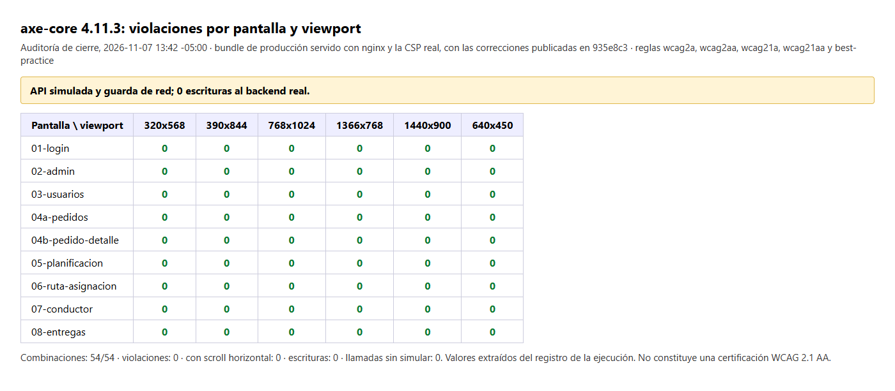
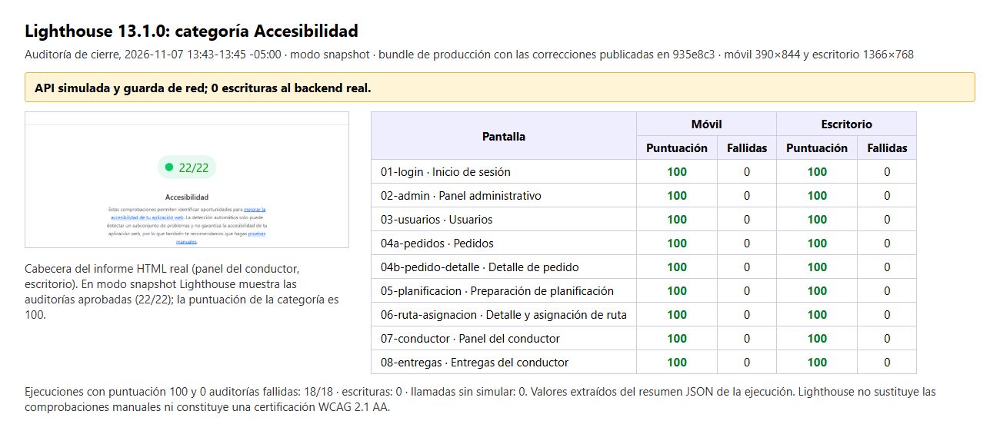
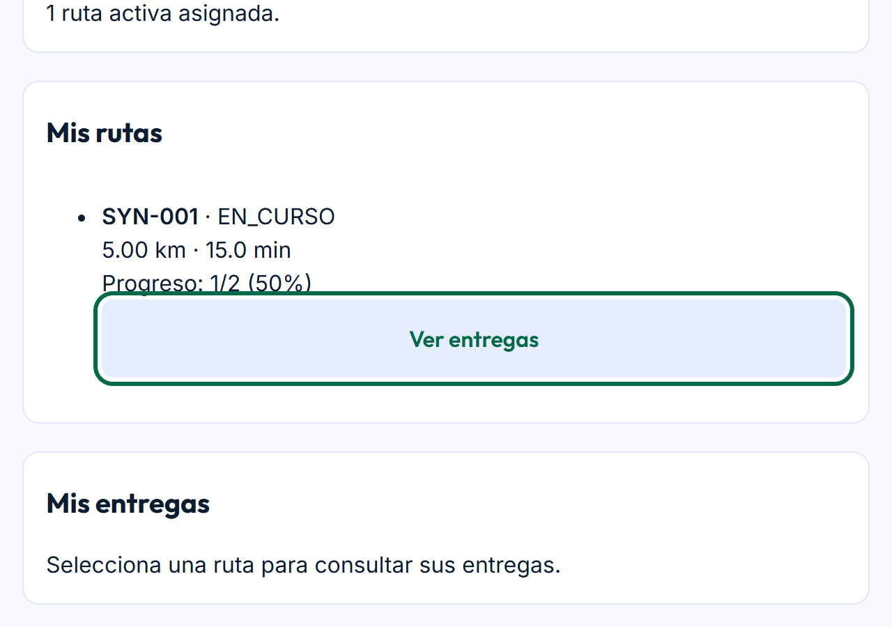

# 05 WCAG V_1_1_0

> Sprint 3 · Informe histórico V_1_1_0. Resultados sobre `33e7601` (noviembre de 2026), no sobre el HEAD actual. Traslado documental a la ruta oficial el 2026-11-12; no se repitieron pruebas, auditorías ni reuniones.

[Evidencia técnica conservada](../evidencias-tecnicas/Sprint-3/cierre/06%20Evidencia%20técnica%20de%20cierre%20del%20Sprint%203%20V_1_1_0.md) · [Otros informes del Sprint 3](../../README.md#sprint-3--ubicación-oficial)

## Identificación

- Versión del documento: V_1_1_0 (sustituye a V_1_0_0, disponible en el historial de Git)
- Fecha de actualización: 2026-11-07 -05:00
- Rama: main
- Commit final evaluado: 33e7601 (33e76018d3c656d1702d059765c518368d482234), 2026-11-07 14:57:19 -05:00
- Commit de integración original: debc2e7 (PR #12), 2026-10-30
- Validación funcional con OSRM local: 2026-11-06, commit 600564f
- Habilitación de la asignación desde la interfaz (HGR-34): 7745ef3, 2026-11-06 23:04:17 -05:00
- Análisis SonarQube final: análisis 9 sobre 33e7601, 2026-11-07 14:59:42 -05:00, Quality Gate OK
- Frontend desplegado localmente desde 33e7601: imagen sha256:98cfee35ba8a…, 2026-11-07 15:15:55 -05:00

## Alcance

Nueve estados de pantalla: inicio de sesión, panel administrativo, usuarios, pedidos, detalle de pedido, preparación de planificación, detalle y asignación de ruta, panel del conductor y entregas del conductor.

## Método

- Bundle de producción servido con nginx y la CSP real; API simulada por completo con datos sintéticos: 0 escrituras y 0 llamadas sin simular.
- Herramientas: Playwright 1.63.0 con Microsoft Edge, axe-core 4.11.3 (reglas wcag2a, wcag2aa, wcag21a, wcag21aa y best-practice) y Lighthouse 13.1.0 en modo snapshot.
- Viewports: 320×568, 390×844, 768×1024, 1366×768, 1440×900 y 640×450 (aproximación de 1280×900 al 200%).
- No se instalaron dependencias en el proyecto.

## Resultados automáticos

| Prueba | Antes (ad1a963) | Después (33e7601) |
|---|---|---|
| axe, 54 combinaciones | 2 violaciones serious (12 ocurrencias) | 0 critical, 0 serious, 0 moderate, 0 minor |
| Scroll horizontal | 0 | 0 |
| Lighthouse Accessibility, 18 ejecuciones (móvil 390 y escritorio 1366) | 100, con `label-content-name-mismatch` fallida | 100 en 18/18, sin auditorías fallidas |
| E2E sobre la imagen desplegada, con API simulada | — | 112/112 |

axe deja 43 resultados `color-contrast` como incompletos porque el fondo contiene una imagen; requieren revisión humana.

*Figura 1. axe-core 4.11.3: 0 violaciones en las 54 combinaciones (9 pantallas × 6 viewports), auditoría del 2026-11-07 13:42 -05:00 sobre el bundle de producción con las correcciones publicadas en `935e8c3`; sobre la imagen de `33e7601` se repitió en 15 combinaciones con 0 violaciones. API simulada y guarda de red; 0 escrituras al backend real.*

*Figura 2. Lighthouse 13.1.0 en modo snapshot: categoría Accesibilidad 100 y 0 auditorías fallidas en 18/18 ejecuciones (móvil y escritorio), 2026-11-07 13:43-13:45 -05:00. Cabecera del informe HTML real y tabla extraída del resumen JSON. API simulada y guarda de red.*

## Hallazgos corregidos

| Hallazgo | Criterio | Corrección |
|---|---|---|
| `definition-list` en el resumen administrativo | 1.3.1 | El icono decorativo pasa al interior de `<dt>` con `aria-hidden="true"` |
| `aria-command-name` en las flechas del mapa de ruta | 4.1.2 | Flechas con `interactive: false` y `keyboard: false`; origen y paradas con `keyboard: false`, conservando `title` y puntero |
| Nombre accesible de los accesos rápidos más corto que el texto visible | 2.5.3 | Se elimina el `aria-label`; el nombre es el texto visible completo y solo la flecha queda oculta |
| Distritos del mapa de entrega como paradas de tabulación sin nombre | 2.4.3 / 4.1.2 | `tabindex="-1"` en los distritos informativos; se conservan geometría, colores y tooltip |
| Controles de zoom en inglés en una página en español | 3.1.2 | «Acercar» y «Alejar» en los tres mapas |

Commits: `935e8c3` y `33e7601`.

## Teclado

- Recorrido con Tab y Shift+Tab en 9 estados a 1440 y 390 px: sin trampas de teclado, sin marcadores ni distritos enfocables y sin elementos enfocables sin nombre; indicador de foco visible (outline de 3 px).
- Enlace «Saltar al contenido»: 16/16 recorridos llevan el foco a `main#main-content`.
- Menú móvil: 8/8 abren con Enter y Espacio, cierran con Escape y devuelven el foco al botón.
- Formularios de inicio de sesión y nuevo usuario: campos inválidos con `aria-invalid` y mensaje asociado por `aria-describedby`; el foco va al primer campo con error.
- Reflow: sin scroll horizontal a 320 px ni en el equivalente al 200%.

*Figura 3. Foco visible (contorno de 3 px) en «Ver entregas» del panel del conductor tras recorrer la página con Tab; viewport de 640×450 con factor 2, equivalente a una ventana de 1280×900 al 200 %, sin scroll horizontal. Frontend desplegado desde `33e7601`, 2026-11-07; API simulada con datos sintéticos y 0 escrituras.*

## Revisión manual del equipo

Revisión manual realizada por el equipo el 2026-11-07 sobre el frontend desplegado localmente desde `33e7601` (imagen sha256:98cfee35ba8a…), con Microsoft Edge. Las comprobaciones siguientes resultaron satisfactorias:

| Comprobación | Resultado |
|---|---|
| Navegación completa mediante teclado | Satisfactoria |
| Recorrido con Tab y Shift+Tab | Satisfactorio |
| Activación de controles con Enter y Espacio | Satisfactoria |
| Cierre de menús mediante Escape | Satisfactorio |
| Foco visible | Satisfactorio en el recorrido general |
| Zoom real del navegador al 200% y al 400% | Satisfactorio |
| Ausencia de desplazamiento horizontal | Satisfactoria |
| Legibilidad de formularios, tablas, menús y panel del conductor | Satisfactoria |
| Contraste en estados normal, hover, focus y disabled | Satisfactorio en revisión visual; sin medición instrumental de la relación de contraste |
| Controles del mapa «Acercar», «Alejar» y «Centrar» | Funcionan correctamente |
| Navegación del panel del conductor: Mi cuenta, Mi jornada, Mis rutas y Mis entregas | Satisfactoria |

Esta revisión no incluyó una prueba con lector de pantalla real ni una evaluación de los mapas con personas usuarias.

## Verificaciones pendientes

1. Prueba con lector de pantalla real (Narrador o NVDA).
2. Medición reproducible de la relación de contraste en estados hover, focus y disabled; la revisión visual del equipo fue satisfactoria, pero no constituye una medición.
3. Contraste sobre fondos con imagen: axe deja 43 resultados `color-contrast` como incompletos y no se han medido manualmente.
4. Comprensión de los mapas sin información visual, que no se ha comprobado con personas usuarias.
5. Claridad del lenguaje.

## Observaciones y deuda

- **H1:** al recuperar el foco de la ventana se revalida la sesión y se vuelve a montar la vista; el foco cae al inicio de la página, se pierde la contraseña escrita en el inicio de sesión y se cierra la lista de entregas (2.4.3, 3.3).
- **Rotación de las flechas de sentido:** la CSP bloquea el estilo en línea y las flechas no rotan; pendiente de clases CSS predefinidas.
- El segundo segmento del campo nativo de fecha y hora no muestra contorno de foco propio.
- A 390 px, el botón «Centrar» aparece sobre el mapa, pero va después en el orden del DOM.
- En la evidencia visual al 200%, el contorno de foco del botón «Ver entregas» se superpone ligeramente con la línea de progreso adyacente. El foco permanece visible y el contenido continúa legible, pero se recomienda ajustar el espaciado vertical del componente en una mejora posterior.
- El marcador de origen del mapa de alternativas conserva la configuración de teclado por defecto de Leaflet; no se evaluó en ese estado.
- Los mapas no deben depender exclusivamente del color: las listas, métricas, advertencias y enlaces de detalle funcionan como representación textual complementaria.
- Limitaciones del entorno: teselas de OpenStreetMap bloqueadas a propósito, antivirus local que altera la CSP del navegador y evaluación solo con Edge.

## Conclusión

Las pruebas automáticas (axe y Lighthouse), la batería de teclado y la revisión manual del equipo sobre el frontend desplegado desde `33e7601` resultaron satisfactorias en los estados evaluados. **No se declara conformidad WCAG 2.1 AA porque permanecen verificaciones pendientes**, entre ellas la prueba con lector de pantalla real, la medición reproducible del contraste y la comprensión de los mapas sin información visual. Además, quedan abiertas H1 y la rotación de las flechas.

---

## Historial documental de ubicación

| Versión | Fecha | Cambio |
|---|---|---|
| V_1_0_0 | Véase historial Git | Versión inicial anterior, no recreada ni duplicada. |
| V_1_1_0 | Actualización técnica registrada: 2026-11-07; evidencias posteriores: 2026-11-08 | Se mantiene la justificación y el detalle histórico del informe. |
| V_1_1_0, corrección de ubicación | 2026-11-12 | Traslado desde `evidencias-tecnicas/Sprint-3/cierre/` a `Sprint 03/`, enlaces ajustados. No es una nueva medición. |

[← Volver al README principal](../../../README.md) · [Índice documental](../../README.md)
