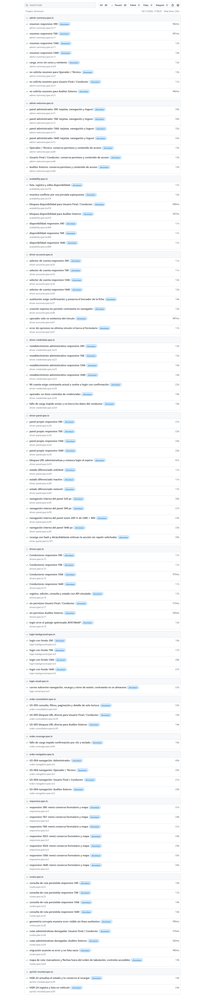
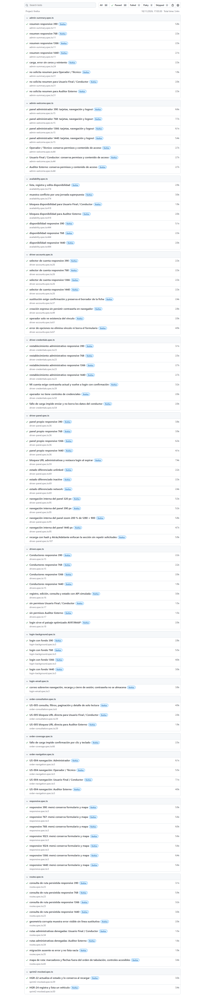
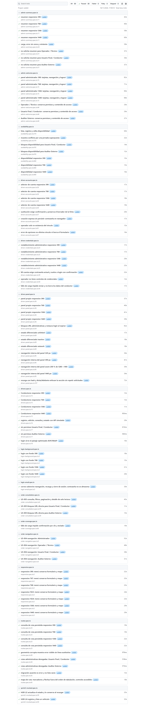
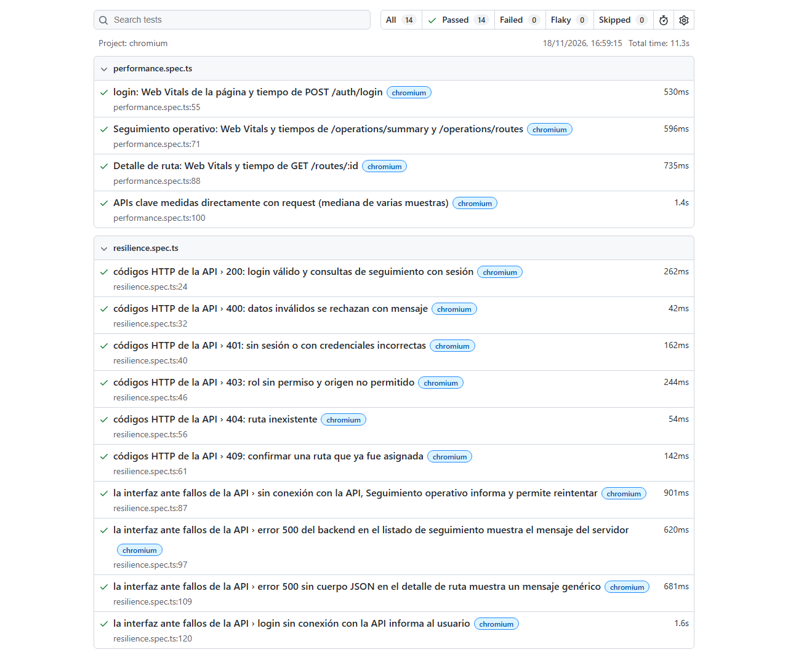
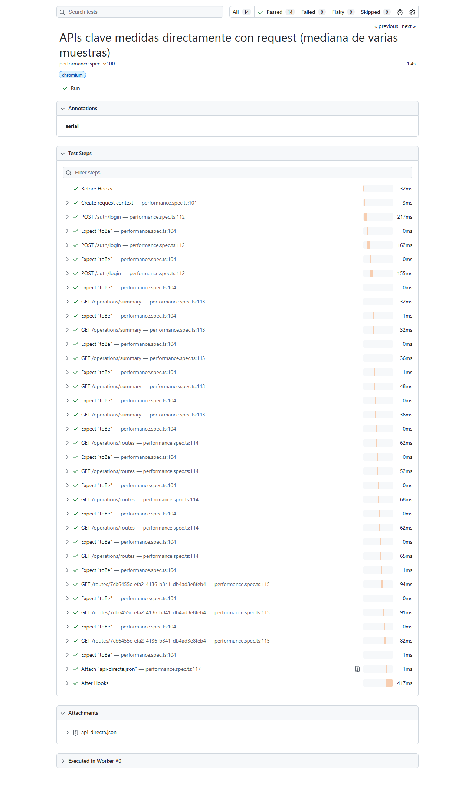
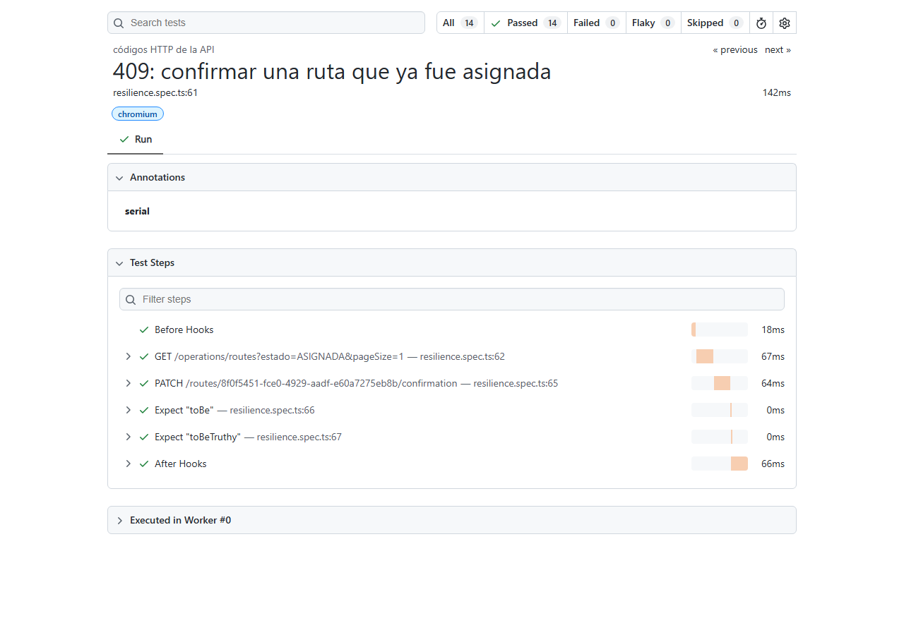
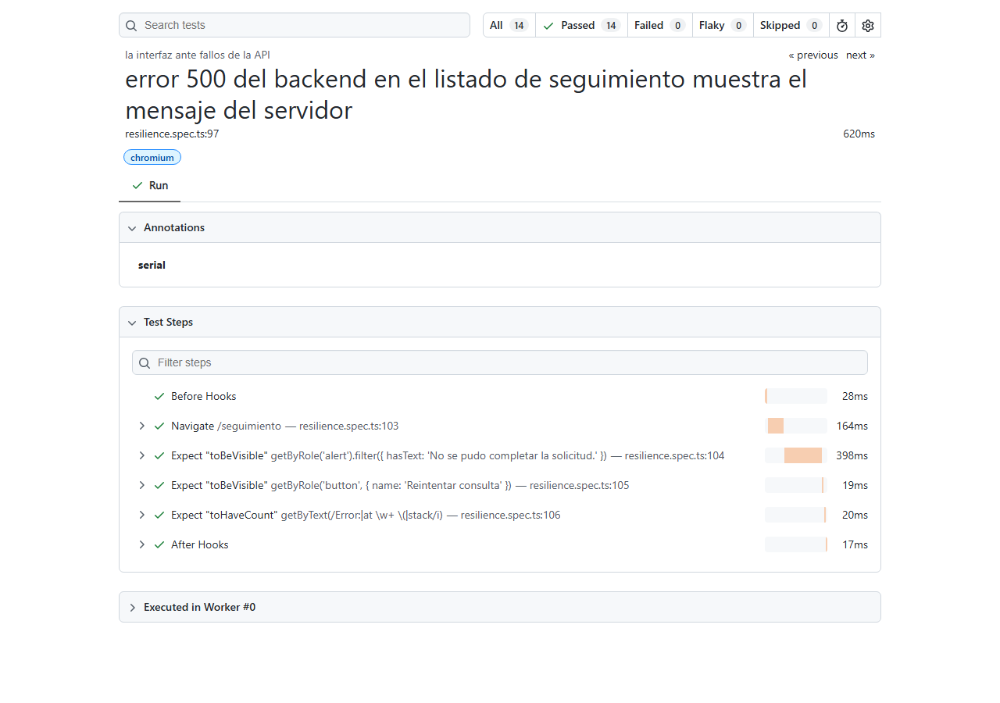

# Análisis Playwright

[← Volver al README principal](../../../README.md) · [Índice documental](../../README.md)

**Nombre del Proyecto:** DistriRapido — Sistema de planificación y seguimiento de entregas de última milla

**Líder del Proyecto:** Rupay Chira, Rosalyn Exkra

> Sprint 4 · Versión V_1_0_0 · Fecha de medición: 2026-11-18 (America/Lima). Código de la aplicación: `cc3ad8c` (US-021), sin cambios posteriores en `src/`. Pruebas ejecutadas en la rama `docs/sprint-4-cierre`, commits `7b20a39` (mediciones) y `d62dc99` (suite por navegador).

## 1. Configuración del entorno de pruebas

### 1.1 Estructura de `src/frontend/e2e/`

| Elemento | Contenido |
|---|---|
| `*.spec.ts` simulados (16 archivos en la allowlist) | Interceptan la API con `page.route` y no escriben datos reales: autenticación, panel de administración, usuarios, vehículos, conductores, cuentas y credenciales de conductor, disponibilidad, pedidos, planificación y rutas, panel del conductor y diseño adaptable. |
| `performance.spec.ts` | Web Vitals y tiempos de API contra el entorno levantado (sección 3). |
| `resilience.spec.ts` | Códigos HTTP reales y mensajes de la interfaz ante fallos de la API (sección 4). |
| `live-env.ts` | Variables del entorno en vivo (`E2E_LIVE`, `E2E_API_URL`, credenciales). Ninguna credencial se versiona. |
| `fixtures/driver-profile.ts` | Perfil de conductor simulado compartido. |
| `login.spec.ts`, `orders.spec.ts`, `users.spec.ts`, `order-address.spec.ts`, `order-delivery-time.spec.ts` | Specs históricos que no están en la allowlist simulada (`login`, `orders` y `users` usan login o escrituras reales); no forman parte de `playwright.ci.config.ts`. |

### 1.2 Archivos de configuración

| Archivo | Uso | Navegadores |
|---|---|---|
| `playwright.config.ts` | Configuración histórica contra el servidor de desarrollo, proyectos `mobile` (390 px) y `desktop` (1440 px). | Edge (`channel: msedge`) |
| `playwright.mock.config.ts` | Allowlist de los 16 specs simulados, `workers: 1`. | Edge (`channel: msedge`) |
| `playwright.ci.config.ts` | Hereda la allowlist del anterior y la ejecuta contra el build de producción (`vite preview`) en los tres motores, con `retries: 1`, reporte HTML, trazas y capturas solo en fallos. Excluye los tests `@cobertura-privada` (sección 2.3). | Chromium, Firefox, WebKit |
| `playwright.live.config.ts` | `performance.spec.ts` y `resilience.spec.ts` contra el entorno levantado; carpetas propias `playwright-report-live/` y `test-results-live/`. | Chromium |

`playwright.ci.config.ts` lo usa el job `e2e` de [`tests.yml`](../../../.github/workflows/tests.yml), con una matriz `chromium` / `firefox` / `webkit` y el reporte HTML publicado como artifact (`playwright-report-<navegador>`).

```ts
// src/frontend/playwright.ci.config.ts (extracto)
export default defineConfig({
  ...mock,
  retries: 1,
  grepInvert: /@cobertura-privada/,
  reporter: [['list'], ['html', { open: 'never', outputFolder: 'playwright-report' }]],
  projects: [
    { name: 'chromium', use: { ...devices['Desktop Chrome'], viewport: { width: 1440, height: 900 } } },
    { name: 'firefox', use: { ...devices['Desktop Firefox'], viewport: { width: 1440, height: 900 } } },
    { name: 'webkit', use: { ...devices['Desktop Safari'], viewport: { width: 1440, height: 900 } } },
  ],
  webServer: { command: 'npm run preview -- --port 5173 --strictPort', url: 'http://localhost:5173' },
});
```

### 1.3 Entorno de ejecución

| Elemento | Valor |
|---|---|
| Equipo | Windows 11 Pro 10.0.26200, Intel Core i5-12500H (12 núcleos / 16 hilos), 16 GB de RAM |
| Node.js / Playwright | Node 26.13.1 en local (la CI usa Node 24) · `@playwright/test` 1.63.0 |
| Motores | Chromium 153.0.8010.12 · Firefox 155.0 · WebKit 26.6 |
| Base de datos | PostgreSQL 16.15 en Docker 29.5.3, levantado con `docker compose` en un proyecto aislado (`distrirapido-perf`) con un volumen nuevo y las 13 migraciones aplicadas |
| Backend | NestJS compilado (`npm run build` → `node dist/main.js`) en `localhost:3000` |
| Frontend | Build de producción (`npm run build`) servido con `vite preview` en `localhost:4173` |
| Datos | Sintéticos, solo en la base desechable: 1 administrador, 1 usuario conductor, 6 conductores, 4 vehículos y 20 rutas de 8 paradas (6 `EN_CURSO`, 6 `COMPLETADA`, 4 `ASIGNADA`, 4 `GENERADA`) con 6 incidencias |

**Por qué no se usó `docker compose build` para el backend y el frontend.** Ambos Dockerfiles copian `geodata/coverage/v1/`. Es el paquete de cobertura INEI que cada integrante genera en local a partir de la descarga oficial, y no se versiona porque su licencia de redistribución no está acreditada (ver [geodata/README.md](../../../geodata/README.md)). Sin ese paquete, la construcción de las imágenes falla. Por eso se levantó PostgreSQL con Docker Compose y se ejecutaron el backend compilado y el build de producción del frontend directamente con Node. Sin el paquete, el backend permite iniciar sesión y consultar, pero responde 503 al registrar pedidos nuevos; eso no afecta a los flujos medidos. OSRM no se levantó: ninguna de las páginas medidas calcula recorridos.

## 2. Pruebas E2E

### 2.1 Casos críticos cubiertos

| Área | Specs | Qué verifican |
|---|---|---|
| Autenticación y sesión | `login-email`, `login-background`, `admin-welcome`, `order-navigation`, `resilience` | Inicio y cierre de sesión, el correo se conserva sin guardar la contraseña, redirección según el rol, URLs bloqueadas para roles sin permiso, sesión expirada, login sin conexión con la API |
| Flujos de rutas | `routes`, `resilience` | Consulta de una ruta persistida (390–1440 px), geometría corrupta, rutas denegadas a Conductor y Auditor, migración ausente, accesibilidad del mapa, 404 de ruta inexistente y 409 al confirmar una ruta ya asignada |
| Seguimiento operativo (US-019) | `performance`, `resilience` | La página carga resumen y rutas con datos reales; ante fallos de la API muestra el mensaje y permite reintentar |
| Incidencias (US-018) | Sin spec E2E | Cubierto por Vitest y por `driver-incidents.integration.ts` (ver sección 5) |
| Formularios | `drivers`, `availability`, `driver-accounts`, `driver-credentials`, `sprint2-mocked`, `order-consultation`, `order-coverage`, `order-marker-sync` | Alta y edición de conductores, disponibilidad con conflictos, vinculación de cuentas, restablecimiento de credenciales, registro de vehículos (HGR-24), estado de pedidos (HGR-22), filtros y paginación de pedidos, destino dentro de la cobertura |
| Diseño adaptable | `responsive`, `admin-summary` y los bucles por ancho de los specs anteriores | Sin desplazamiento horizontal de 320 a 1440 px; el menú conserva los formularios |

### 2.2 Fragmentos relevantes

Mocks limitados a las rutas de la API. Con el build de producción, el glob `'**/drivers**'` interceptaba también el chunk `assets/drivers-api-*.js`, la página quedaba en blanco y fallaban `drivers.spec.ts` y `availability.spec.ts` en los tres navegadores. Se corrigió en el commit `9fe14f9`:

```ts
// e2e/drivers.spec.ts
await page.route(url => /^\/drivers(\/|$)/.test(url.pathname), async r => { /* … */ });
```

Contrato paginado vigente. `order-navigation` y `sprint2-mocked` (HGR-24) devolvían arreglos, pero `/users` y `/vehicles` responden ahora `Page<T>`. Se corrigió en el commit `7b20a39`:

```ts
// e2e/order-navigation.spec.ts
await page.route(url => url.pathname === '/users', async route => {
  const items = [{ ...user, rol_id: user.rol.rol_id, estado: 'ACTIVO', creado_en: new Date().toISOString() }];
  await route.fulfill({ status: 200, headers, json: { items, total: items.length, page: 1, pageSize: 20 } });
});
```

Seguimiento operativo con sesión real y la API caída:

```ts
// e2e/resilience.spec.ts
await page.route(apiPath(/^\/operations\//), route => route.abort('connectionrefused'));
await page.goto('/seguimiento');
await expect(page.getByRole('alert').filter({ hasText: 'No se pudo conectar al servidor. Inténtalo de nuevo.' }).first()).toBeVisible();
await page.unrouteAll({ behavior: 'ignoreErrors' });
await page.getByRole('button', { name: 'Reintentar consulta' }).click();
await expect(page.getByText(/PRF-10\d/).first()).toBeVisible();
```

### 2.3 Tests que dependen de la cobertura privada (`@cobertura-privada`)

Doce tests necesitan los cinco distritos de `geodata/coverage/v1/coverage.geojson`. Sin el paquete, el botón «Ver cobertura» queda deshabilitado, el mapa no dibuja distritos y la búsqueda de direcciones no devuelve sugerencias (`useDeliveryAddress` no consulta Photon si no hay cobertura). Como el paquete no existe en GitHub Actions, se etiquetaron `@cobertura-privada` y `playwright.ci.config.ts` los excluye con `grepInvert`. **No se eliminaron:** se ejecutan en local con `playwright.mock.config.ts` cuando el paquete está aprovisionado (`node scripts/provision-coverage.cjs`).

| Spec | Tests excluidos en CI |
|---|---|
| `order-coverage.spec.ts` | «cobertura responsive 390 / 768 / 1366 / 1440, Photon ambiguo y selección» (4) · «arrastre fuera de cobertura invalida y bloquea POST» (1) |
| `order-marker-sync.spec.ts` | «selección HUANCAYO / EL TAMBO / CHILCA centra marcador…» (3) · «clic y arrastre confirman las coordenadas reales…» (1) · «editar y errores Photon no conservan confirmación falsa…» (1) |
| `routes.spec.ts` | «origen/orden/regreso explícitos, fallo OSRM y nueva clave…» (1) · «mapa de entrega en planificación: distritos fuera de la tabulación…» (1) |

`order-coverage.spec.ts:66` («fallo de carga impide confirmación…») comprueba justamente el caso sin cobertura, así que sigue en la CI.

### 2.4 Resultados por navegador

`npx playwright test -c playwright.ci.config.ts --project=<navegador> --workers=1`, un navegador a la vez, el 2026-11-18 (commit `d62dc99`):

| Navegador | Pasadas | Fallidas | Omitidas | Flaky | Duración | Excluidos por `@cobertura-privada` |
|---|---|---|---|---|---|---|
| Chromium 153 | 89 | 0 | 0 | 0 | 2.8 min | 12 |
| Firefox 155 | 89 | 0 | 0 | 0 | 5.4 min | 12 |
| WebKit 26.6 | 89 | 0 | 0 | 0 | 4.4 min | 12 |

No hubo fallos exclusivos de Firefox o WebKit. Historial de las ejecuciones anteriores a las correcciones, sobre los 101 tests por navegador de entonces:

| Ejecución | Chromium | Causa de los fallos |
|---|---|---|
| 1 (commit `0ff99e0`) | 77 pasadas · 24 fallidas | 10 por el glob `'**/drivers**'` (`drivers` 5, `availability` 5), 2 por contratos no paginados (`order-navigation`, HGR-24) y 12 por la cobertura privada |
| 2 (commit `9fe14f9`) | 87 pasadas · 14 fallidas | 2 por contratos no paginados y 12 por la cobertura privada |

En la ejecución 1, Firefox mostró los mismos fallos de mocks y de cobertura en los specs que alcanzó a ejecutar. Esa ejecución se detuvo a mitad de camino y las dos ejecuciones combinadas de los tres navegadores se interrumpieron por falta de memoria del equipo. Los cierres abruptos del worker (`exit code 3221225794`) registrados al detenerlas no son fallos de las pruebas. Por eso la versión final se ejecutó un navegador a la vez.

| Chromium | Firefox | WebKit |
|---|---|---|
|  |  |  |

## 3. Monitoreo de rendimiento

**Método.** `performance.spec.ts` registra un `PerformanceObserver` de `largest-contentful-paint` (con `buffered: true`) antes de que cargue la página. Lee el TTFB de `PerformanceNavigationTiming.responseStart` y el FCP de la entrada `first-contentful-paint`, después de que los datos están en pantalla. Los tiempos de API se miden de dos formas: en el navegador, con `page.waitForResponse` y `request().timing().responseEnd`, y de forma directa, con el cliente `request` de Playwright (3 a 5 muestras por endpoint, por el límite de 10 peticiones por minuto del backend). Se hicieron 3 corridas separadas por 65 s y se informa la mediana.

**Fecha:** 2026-11-18, 21:56–21:59 UTC · **Commit:** `7b20a39` (código de la aplicación igual a `cc3ad8c`) · **Entorno:** local, descrito en 1.3, sin latencia de red.

### 3.1 Web Vitals (mediana de 3 corridas, Chromium)

| Página | TTFB | FCP | LCP | Umbral «bueno» (TTFB ≤ 800 ms · FCP ≤ 1800 ms · LCP ≤ 2500 ms) |
|---|---|---|---|---|
| Login (`/login`) | 9 ms (9 / 11 / 9) | 148 ms (132 / 148 / 148) | 176 ms (164 / 176 / 192) | Cumple |
| Seguimiento operativo (`/seguimiento`) | 4 ms (3 / 5 / 4) | 56 ms (56 / 76 / 52) | 428 ms (436 / 428 / 420) | Cumple |
| Detalle de ruta (`/rutas/:id`) | 6 ms (6 / 4 / 6) | 80 ms (80 / 44 / 112) | 396 ms (396 / 376 / 400) | Cumple |

### 3.2 Tiempos de respuesta de las APIs clave (mediana de 3 corridas)

| Endpoint | Navegador (`waitForResponse`) | Directo (`request`) | ¿< 500 ms? |
|---|---|---|---|
| `POST /auth/login` | 169 ms (159 / 169 / 170) | 175 ms (175 / 223 / 164) | Sí |
| `GET /operations/summary` | 39 ms (47 / 28 / 39) | 38 ms (42 / 38 / 37) | Sí |
| `GET /operations/routes` | 62 ms (87 / 52 / 62) | 61 ms (61 / 61 / 63) | Sí |
| `GET /routes/:id` | 98 ms (139 / 98 / 85) | 90 ms (88 / 90 / 92) | Sí |

El login es el endpoint más lento porque verifica la contraseña con Argon2id, un costo deliberado como protección contra ataques de fuerza bruta. `GET /routes/:id` recalcula las advertencias vigentes de la ruta contra la base de datos en cada consulta.





## 4. Disponibilidad y resiliencia

`resilience.spec.ts` pasó 10 de 10 tests en cada una de las 3 corridas.

### 4.1 Códigos HTTP del backend real

| Código | Caso verificado |
|---|---|
| 200 | `POST /auth/login` válido (cookie `HttpOnly`), `GET /operations/summary` y `GET /operations/routes` con sesión |
| 400 | `POST /auth/login` con correo inválido; `GET /operations/routes?estado=INEXISTENTE` con mensaje de validación |
| 401 | `GET /operations/summary` sin sesión; `POST /auth/login` con contraseña incorrecta |
| 403 | Usuario con rol «Usuario Final / Conductor» en `GET /operations/summary`; `POST /auth/login` con `Origin` no permitido |
| 404 | `GET /routes/:id` y `GET /operations/routes/:id` con un UUID inexistente |
| 409 | `PATCH /routes/:id/confirmation` sobre una ruta `ASIGNADA`, con mensaje |

### 4.2 Comportamiento de la interfaz ante fallos de red y del servidor

| Fallo simulado (`page.route` solo sobre la API) | Resultado en la interfaz |
|---|---|
| `/operations/*` abortado (`connectionrefused`) | «No se pudo conectar al servidor. Inténtalo de nuevo.» en una región `alert`; «Reintentar consulta» recupera los datos al restablecer la API |
| `GET /operations/routes` con 500 y el cuerpo JSON del filtro global del backend | Muestra «No se pudo completar la solicitud.» y el botón de reintento, sin trazas ni texto técnico |
| `GET /routes/:id` con 500 y cuerpo HTML (proxy caído) | Muestra el mensaje genérico «No se pudo completar la operación de rutas.» y el botón de reintento |
| `POST /auth/login` abortado | El formulario informa «No se pudo conectar al servidor. Inténtalo de nuevo.» y la página sigue en `/login` |

| 409 al confirmar | 500 en Seguimiento operativo |
|---|---|
|  |  |

## 5. Conclusiones y limitaciones

**Conclusiones**

- La suite simulada pasa 89 de 89 tests en Chromium, Firefox y WebKit contra el build de producción, sin fallos propios de ningún navegador y sin tests flaky.
- Las tres páginas medidas cumplen con amplio margen los umbrales «buenos» de Web Vitals. El LCP más alto es de 428 ms, en Seguimiento operativo.
- Las cuatro APIs clave responden en menos de 500 ms. La más lenta es el login, con 169–175 ms.
- El backend devuelve los códigos esperados (200, 400, 401, 403, 404 y 409), y la interfaz muestra mensajes comprensibles y permite reintentar ante caídas o errores 500.
- Ejecutar la suite contra el build de producción reveló dos defectos de las pruebas que no aparecían contra el servidor de desarrollo: mocks demasiado amplios y contratos no paginados. Ambos se corrigieron sin tocar la aplicación.

**Limitaciones**

- **Entorno local y sin red.** Las mediciones se hicieron en un único equipo, con todos los servicios en `localhost`, sin limitar CPU ni red y con un volumen de datos sintético pequeño (20 rutas). Un despliegue real sumará la latencia de red y, con más datos, los listados pueden tardar más. Las cifras son útiles para comparar entre versiones, no como rendimiento de producción. En una corrida de prueba previa, que no se incluye en las tablas, `GET /operations/routes` llegó a 2.2 s mientras la suite de tres navegadores ocupaba la CPU del mismo equipo.
- **Solo Chromium para Web Vitals.** WebKit no expone LCP, así que las métricas de rendimiento se tomaron en un único motor.
- **Muestras limitadas.** El backend limita `/auth/login` y `/routes/*` a 10 peticiones por minuto por cliente, por lo que se tomaron 3 muestras directas de esos endpoints y 5 de los de `/operations`.
- **Imágenes Docker de la aplicación.** No se construyeron porque requieren el paquete INEI privado (sección 1.3).
- **12 tests fuera de la CI.** Los `@cobertura-privada` solo se ejecutan en local con el paquete aprovisionado; en esta revisión no se ejecutaron porque el paquete no está en este equipo.
- **Historias sin E2E.** No hay specs E2E simulados para registrar incidencias (US-018), confirmar ruta (US-020) ni registrar sostenibilidad (US-021). Seguimiento operativo (US-019) solo está cubierto por los specs contra el entorno levantado. Estas historias tienen pruebas de Vitest y de integración con PostgreSQL (informes US-018 a US-021).
- **Fuera de la CI.** `performance.spec.ts` y `resilience.spec.ts` necesitan backend, base de datos y credenciales, por lo que no forman parte de `tests.yml`.
- **Workflow todavía sin ejecutar en GitHub.** `tests.yml` corre por primera vez con el PR de esta rama; los resultados de esta sección son locales. La CI usa Node 24 y el equipo local Node 26.
- **Sin despliegue público.** `deploy-production.yml` queda pendiente hasta que se decida la plataforma, así que no se midió la disponibilidad de un entorno público.

### Reproducir las mediciones

```sh
# Suite simulada, un navegador a la vez
cd src/frontend && npm ci && npx playwright install chromium firefox webkit && npm run build
npx playwright test -c playwright.ci.config.ts --project=chromium --workers=1

# Entorno levantado: backend en :3000 con FRONTEND_ORIGIN=http://localhost:4173 y `npx vite preview --port 4173`
E2E_LIVE=1 E2E_BASE_URL=http://localhost:4173 E2E_API_URL=http://localhost:3000 \
E2E_ADMIN_EMAIL=… E2E_ADMIN_PASSWORD=… E2E_DRIVER_EMAIL=… E2E_DRIVER_PASSWORD=… \
PERF_OUT=perf-run1.json npx playwright test -c playwright.live.config.ts --workers=1
```

Las credenciales se pasan siempre por variables de entorno de la sesión y nunca se versionan.

---

| Versión | Fecha | Cambio |
|---|---|---|
| V_1_0_0 | 2026-11-18 | Versión inicial: E2E en tres navegadores, rendimiento y resiliencia del Sprint 4. |

[← Volver al README principal](../../../README.md)
