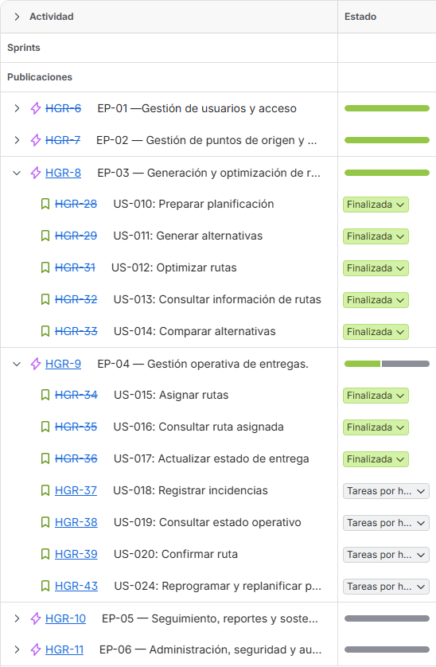
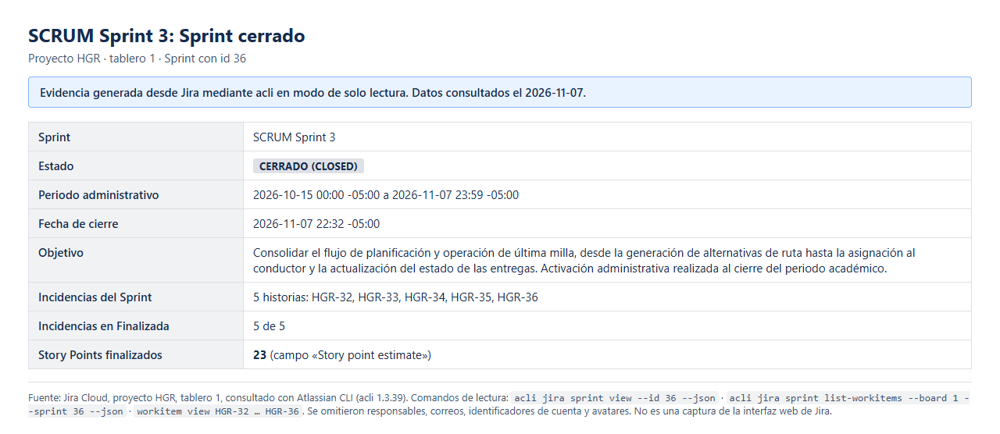
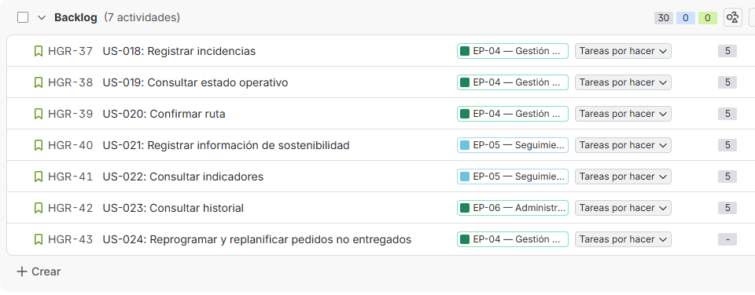

# 01 Revisión del Sprint V_1_1_0

## Identificación

- Versión del documento: V_1_1_0 (sustituye a V_1_0_0, disponible en el historial de Git)
- Fecha de actualización: 2026-11-07 -05:00
- Rama: main
- Commit final evaluado: 33e7601 (33e76018d3c656d1702d059765c518368d482234), 2026-11-07 14:57:19 -05:00
- Commit de integración original: debc2e7 (PR #12), 2026-10-30
- Validación funcional con OSRM local: 2026-11-06, commit 600564f
- Habilitación de la asignación desde la interfaz (HGR-34): 7745ef3, 2026-11-06 23:04:17 -05:00
- Análisis SonarQube final: análisis 9 sobre 33e7601, 2026-11-07 14:59:42 -05:00, Quality Gate OK
- Frontend desplegado localmente desde 33e7601: imagen sha256:98cfee35ba8a…, 2026-11-07 15:15:55 -05:00

## Objetivo del Sprint

Consolidar el flujo de planificación y operación de última milla, desde la generación de alternativas de ruta hasta la asignación al conductor y la actualización del estado de las entregas.

## Historias integradas

- **HGR-32 (US-013):** consulta de información de rutas registradas.
- **HGR-33 (US-014):** generación y comparación de alternativas de ruta.
- **HGR-34 (US-015):** asignación de rutas a conductores, con control de versión en el backend y flujo de asignación en la interfaz desde `7745ef3`.
- **HGR-35 (US-016):** consulta de la ruta asignada por el conductor autenticado.
- **HGR-36 (US-017):** actualización del estado de las entregas y del progreso de la ruta.

## Incremento entregado

1. Preparación de planificación con origen, pedidos, vehículo y conductores.
2. Generación de alternativas secuenciales con OSRM local y métricas registradas.
3. Visualización de geometrías, advertencias y comparación de recorridos.
4. Asignación de ruta a un conductor desde la interfaz (`7745ef3`) sobre el endpoint `PATCH /routes/:id/assignment`, con control de versión y estado.
5. Panel del conductor con navegación interna por secciones (Mi cuenta, Mi jornada, Mis rutas, Mis entregas), foco gestionado y textos corregidos (`d66a5df`, `ad1a963`).
6. Registro de entregas como ENTREGADA o NO_ENTREGADA con causa obligatoria, control de versión y progreso de ruta; los mensajes del backend se muestran sin alterarse (`555b2a1`).
7. Correcciones de accesibilidad WCAG 2.1 AA detectadas por la auditoría automática (`935e8c3`, `33e7601`).
8. Persistencia mediante migraciones de Prisma y PostgreSQL.

## Estado de las historias

El estado técnico corresponde a lo demostrado en el entorno local. El estado administrativo es el registrado en Jira, consultado en solo lectura el 2026-11-07.

| Historia | Implementación | Estado técnico demostrado | Estado administrativo en Jira |
|---|---|---|---|
| HGR-32 | Consulta y detalle de rutas | Validada con OSRM local (2026-11-06) y E2E con API simulada | Finalizada, resolución Listo |
| HGR-33 | Alternativas y comparación | Validada con OSRM local (2026-11-06) | Finalizada, resolución Listo |
| HGR-34 | Backend y, desde `7745ef3`, interfaz de asignación | Asignación validada desde la interfaz; 3 rutas asignadas y completadas en la base local. Rechazo de conductor no disponible cubierto por pruebas automatizadas. Verificación manual complementaria pendiente: comprobar a mano el rechazo 409 en otra ruta GENERADA | Finalizada, resolución Listo |
| HGR-35 | Consulta de rutas propias del conductor | Validada con un conductor de prueba | Finalizada, resolución Listo |
| HGR-36 | Registro de entregas y progreso | ENTREGADA validada en dos rutas completadas (2 entregas cada una); rechazo 409 sin cambios parciales validado; NO_ENTREGADA validada con causa, con deuda funcional abierta (ver «Deuda funcional») | Finalizada, resolución Listo, con comentarios 10000 (validación y bloqueo), 10001 (decisión del equipo) y 10002 (comentario final) |

*Figura 1. Cronograma de Jira con las épicas HGR-8 y HGR-9 desplegadas: HGR-32 a HGR-36 en Finalizada (claves tachadas por estar resueltas) y HGR-43 en Tareas por hacer; la resolución Listo de las cinco historias se contrastó con acli. Captura directa y sin alteraciones de la interfaz web de Jira, tomada el 2026-11-08. El encuadre excluye datos personales. Datos contrastados mediante acli en modo de solo lectura.*

El Sprint «SCRUM Sprint 3» se activó y se cerró administrativamente en Jira el 2026-11-07, con fechas administrativas del 2026-10-15 al 2026-11-07 (-05:00). Terminó con HGR-32 a HGR-36 en Finalizada, resolución Listo, y 23 Story Points finalizados. La épica HGR-8 se retiró del Sprint 3 antes del cierre y continúa En curso. La deuda de NO_ENTREGADA quedó registrada como HGR-43, en el backlog y pendiente.

*Figura 2. Informe de trabajo completado de SCRUM Sprint 3: periodo del 15 de octubre al 7 de noviembre de 2026, meta del Sprint, alcance y trabajo completado de 23 puntos de historia, retirada de HGR-8 y evento «Sprint completado» del 2026-11-07 22:32. Captura directa y sin alteraciones de la interfaz web de Jira, tomada el 2026-11-08. El encuadre excluye datos personales. Datos contrastados mediante acli en modo de solo lectura.*

## Validación

### Backend

43 suites y 498 pruebas aprobadas (498/498). Cobertura: statements 90.76%, branches 81.46%, functions 87.53%, lines 94.01%.

### Frontend

38 archivos y 362 pruebas aprobadas (362/362; suite completa repetida 3 veces sin fallos intermitentes). Cobertura: statements 87.89%, branches 81.16%, functions 84.97%, lines 92.94%.

### Calidad y accesibilidad

- SonarQube, análisis 9 sobre `33e7601`: Quality Gate OK, `new_violations` = 0, `new_coverage` = 96.3%, `new_duplicated_lines_density` = 0.0%, 0 bugs, 0 vulnerabilidades, 0 hotspots pendientes y 3 hotspots REVIEWED / SAFE (detalle en 03 y 04).
- axe-core 4.11.3: 54/54 combinaciones (9 estados × 6 viewports) con 0 violaciones; Lighthouse Accessibility 100 en 18/18 ejecuciones (detalle en 05). No se declara conformidad WCAG 2.1 AA.
- Imagen del frontend construida desde `33e7601` y desplegada en local: antes de desplegarla, 112/112 pruebas E2E con API simulada y guarda de red, ejecutadas sobre esa misma imagen.

### Integración original

Los checks de backend, frontend, CodeQL y code scanning aprobaron antes de la integración del 2026-10-30. El PR #12 fusionó feature/sprint-3-avances hacia main.

## Deuda funcional

- **NO_ENTREGADA y replanificación (no resuelta):** se validó en local una parada NO_ENTREGADA con causa obligatoria; la ruta quedó COMPLETADA y el pedido quedó PENDIENTE, como establece la decisión del equipo en HGR-36. El backend acepta NO_ENTREGADA aunque el pedido no esté EN_RUTA, la ventana de entrega del pedido está vencida y no existe un flujo para reprogramarla ni un flujo funcional completo de replanificación. Permanece como deuda funcional (detalle en 06). La deuda se registró en Jira como HGR-43 / US-024: Reprogramar y replanificar pedidos no entregados. HGR-43 sigue pendiente en el backlog.

*Figura 3. Backlog del tablero: HGR-43 / US-024: Reprogramar y replanificar pedidos no entregados, en Tareas por hacer y fuera de cualquier Sprint. Captura directa y sin alteraciones de la interfaz web de Jira, tomada el 2026-11-08. El encuadre excluye datos personales. Datos contrastados mediante acli en modo de solo lectura.*
- **Placa histórica (RN-020):** las versiones de ruta guardan solo el identificador del vehículo; si la placa del vehículo cambia, la ruta muestra la placa actual y no la usada al planificar.
- **H1, revalidación de sesión:** al recuperar el foco de la ventana se revalida la sesión y se vuelve a montar la vista; se pierde la contraseña escrita en el inicio de sesión y se cierra la lista de entregas abierta.
- **Rotación de flechas del mapa:** la CSP `style-src 'self'` bloquea el estilo en línea de las flechas de sentido; pendiente de resolver con clases CSS predefinidas, sin debilitar la CSP.

## Demostración local

- Frontend: http://localhost:5173 (imagen construida desde `33e7601`).
- Backend: http://localhost:3000.
- PostgreSQL: 127.0.0.1:5432.
- OSRM local: 127.0.0.1:5000, v26.10.0, perfil driving, revisión `geofabrik-peru-261105-sha256:70cce1d0a42c-car-mld-osrm-v26.10.0`.
- Cobertura geográfica privada v1.0.0 aprovisionada localmente.
- Nueve migraciones reconocidas y esquema actualizado.

## Conclusión

El incremento del Sprint 3 está integrado en main hasta `33e7601`, con el flujo completo ejercitado en local: cálculo vial con OSRM, asignación desde la interfaz, consulta del conductor y registro de entregas hasta completar rutas.

El 2026-11-06 se aprovisionó OSRM local y se validó el cálculo vial real desde la interfaz sobre `600564f`: la ruta de referencia midió 3.89 km, 5.9 min de viaje y 130 min con atención y esperas, con procedencia OSRM y revisión `geofabrik-peru-261105-sha256:70cce1d0a42c-car-mld-osrm-v26.10.0` (detalle en 06 Evidencia técnica de cierre del Sprint 3 V_1_1_0). En la validación del 06/11, antes del commit 7745ef3, la interfaz todavía no ofrecía asignación; la asignación se habilitó después con `7745ef3`.

La calidad final cumple el Quality Gate y la auditoría automática de accesibilidad no registra violaciones. Quedan como deuda la definición de NO_ENTREGADA y su replanificación, la trazabilidad de la placa, la revalidación de sesión (H1), la rotación de las flechas y las comprobaciones manuales de WCAG. En Jira, el Sprint 3 quedó cerrado administrativamente con HGR-32 a HGR-36 en Finalizada y 23 Story Points finalizados; la deuda de NO_ENTREGADA queda pendiente en HGR-43. La deuda de NO_ENTREGADA no se presenta como resuelta.

---

[← Volver al README principal](../../../../../README.md) · [Índice documental](../../../../README.md)
