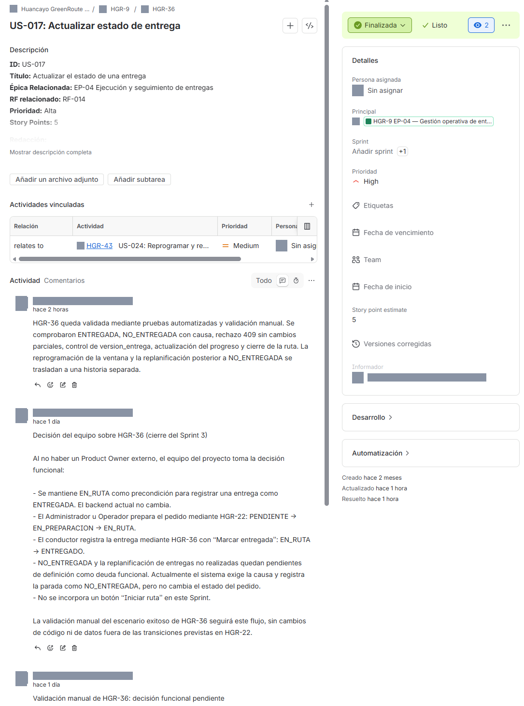

# 06 Evidencia técnica de cierre del Sprint 3 V_1_1_0

## Identificación

- Versión del documento: V_1_1_0 (sustituye a V_1_0_0, disponible en el historial de Git)
- Fecha de actualización: 2026-11-07 -05:00
- Rama: main
- Commit final evaluado: 33e7601 (33e76018d3c656d1702d059765c518368d482234), 2026-11-07 14:57:19 -05:00
- Commit de integración original: debc2e7 (PR #12), 2026-10-30
- Validación funcional con OSRM local: 2026-11-06, commit 600564f
- Habilitación de la asignación desde la interfaz (HGR-34): 7745ef3, 2026-11-06 23:04:17 -05:00
- Análisis SonarQube final: análisis 9 sobre 33e7601, 2026-11-07 14:59:42 -05:00, Quality Gate OK
- Frontend desplegado localmente desde 33e7601: imagen sha256:98cfee35ba8a…, 2026-11-07 15:15:55 -05:00

## Historial Git

### Integración del 2026-10-30

    debc2e7 Merge pull request #12 (feature/sprint-3-avances)
    7325620 merge(main): reconcile Sprint 3 integration
    12614ce Merge pull request #10 (feature/sprint-3-completion)
    4a63a57 test(frontend): cover route geometry branches
    a88c453 test(frontend): stabilize map coverage validation
    b54f92b fix(sprint3): reconcile HGR-33 with route operations
    1f10eb6 Feature/sprint 3 avances delivery alternatives (#11)
    0403ab8 Feature/sprint 3 avances delivery alternatives (#11)

### Commits del cierre técnico (2026-11-06 a 2026-11-07)

    33e7601 refactor(frontend): simplify admin metric rendering
    935e8c3 fix(frontend): resolve sprint 3 accessibility findings
    ad1a963 refactor(frontend): resolve driver panel quality findings
    d66a5df fix(frontend): improve driver panel navigation and encoding
    205ba24 refactor(frontend): resolve route assignment quality findings
    29b5407 test(frontend): wait for login redirect in direct access test
    555b2a1 fix(frontend): preserve driver delivery error messages
    7745ef3 feat(routes): enable conductor assignment workflow

## Servicios Docker (estado del 2026-11-07)

| Servicio | Estado | Observación |
|---|---|---|
| frontend | running, HTTP 200 en 127.0.0.1:5173 | Recreado el 2026-11-07 15:22 -05:00 con la imagen `sha256:98cfee35ba8a…` construida desde `33e7601`; 0 errores en logs |
| backend | running, 0 reinicios | Sin reiniciar durante la recreación del frontend |
| postgres | running, healthy | Sin reiniciar; huellas de datos idénticas antes y después de la recreación |
| osrm | running, `/nearest` con `code=Ok` | Imagen fijada por digest; sin cambios |

Comprobación del bundle desplegado (contenedor temporal sin red): contiene «Acercar», «Alejar», «Cantidad pendiente de carga» y las correcciones del panel del conductor; 0 secuencias de codificación dañadas.

## Servicios Docker (estado del 2026-10-30)

    NAME                               IMAGE                            COMMAND                  SERVICE    CREATED          STATUS                 PORTS
    distrirapido_analisis-backend-1    distrirapido_analisis-backend    "docker-entrypoint.s…"   backend    13 minutes ago   Up 13 minutes          127.0.0.1:3000->3000/tcp
    distrirapido_analisis-frontend-1   distrirapido_analisis-frontend   "/docker-entrypoint.…"   frontend   10 minutes ago   Up 10 minutes          127.0.0.1:5173->80/tcp
    distrirapido_analisis-postgres-1   postgres:16-alpine               "docker-entrypoint.s…"   postgres   4 hours ago      Up 4 hours (healthy)   127.0.0.1:5432->5432/tcp

## Estado de migraciones (2026-10-30)

    Prisma schema loaded from prisma/schema.prisma
    Datasource "db": PostgreSQL database "distrirapido", schema "public" at "postgres:5432"

    9 migrations found in prisma/migrations

    Database schema is up to date!

## Logs recientes del backend (2026-10-30)

    backend-1  | [Nest] 1  - 10/30/2026, 8:42:24 PM     LOG [RoutesResolver] DriverOwnCredentialsController {/driver}: +0ms
    backend-1  | [Nest] 1  - 10/30/2026, 8:42:24 PM     LOG [RouterExplorer] Mapped {/driver/account/password, POST} route +0ms
    backend-1  | [Nest] 1  - 10/30/2026, 8:42:24 PM     LOG [RoutesResolver] DriverAccountsController {/drivers}: +0ms
    backend-1  | [Nest] 1  - 10/30/2026, 8:42:24 PM     LOG [RouterExplorer] Mapped {/drivers/account-options, GET} route +1ms
    backend-1  | [Nest] 1  - 10/30/2026, 8:42:24 PM     LOG [RouterExplorer] Mapped {/drivers/:id/account, PUT} route +0ms
    backend-1  | [Nest] 1  - 10/30/2026, 8:42:24 PM     LOG [RouterExplorer] Mapped {/drivers/:id/account, POST} route +1ms
    backend-1  | [Nest] 1  - 10/30/2026, 8:42:24 PM     LOG [RoutesResolver] DriversController {/drivers}: +0ms
    backend-1  | [Nest] 1  - 10/30/2026, 8:42:24 PM     LOG [RouterExplorer] Mapped {/drivers, GET} route +0ms
    backend-1  | [Nest] 1  - 10/30/2026, 8:42:24 PM     LOG [RouterExplorer] Mapped {/drivers/:id, GET} route +1ms
    backend-1  | [Nest] 1  - 10/30/2026, 8:42:24 PM     LOG [RouterExplorer] Mapped {/drivers, POST} route +0ms
    backend-1  | [Nest] 1  - 10/30/2026, 8:42:24 PM     LOG [RouterExplorer] Mapped {/drivers/:id, PATCH} route +13ms
    backend-1  | [Nest] 1  - 10/30/2026, 8:42:24 PM     LOG [RoutesResolver] DriverProfileController {/driver}: +0ms
    backend-1  | [Nest] 1  - 10/30/2026, 8:42:24 PM     LOG [RouterExplorer] Mapped {/driver/deliveries/:id/status, PATCH} route +1ms
    backend-1  | [Nest] 1  - 10/30/2026, 8:42:24 PM     LOG [RouterExplorer] Mapped {/driver/routes, GET} route +0ms
    backend-1  | [Nest] 1  - 10/30/2026, 8:42:24 PM     LOG [RouterExplorer] Mapped {/driver/routes/:id, GET} route +1ms
    backend-1  | [Nest] 1  - 10/30/2026, 8:42:24 PM     LOG [RouterExplorer] Mapped {/driver/me, GET} route +0ms
    backend-1  | [Nest] 1  - 10/30/2026, 8:42:24 PM     LOG [RoutesResolver] AvailabilityController {/availability}: +0ms
    backend-1  | [Nest] 1  - 10/30/2026, 8:42:24 PM     LOG [RouterExplorer] Mapped {/availability, GET} route +1ms
    backend-1  | [Nest] 1  - 10/30/2026, 8:42:24 PM     LOG [RouterExplorer] Mapped {/availability/:id, GET} route +0ms
    backend-1  | [Nest] 1  - 10/30/2026, 8:42:24 PM     LOG [RouterExplorer] Mapped {/availability, POST} route +0ms
    backend-1  | [Nest] 1  - 10/30/2026, 8:42:24 PM     LOG [RouterExplorer] Mapped {/availability/:id, PATCH} route +1ms
    backend-1  | [Nest] 1  - 10/30/2026, 8:42:24 PM     LOG [RoutesResolver] VehiclesController {/vehicles}: +0ms
    backend-1  | [Nest] 1  - 10/30/2026, 8:42:24 PM     LOG [RouterExplorer] Mapped {/vehicles, GET} route +0ms
    backend-1  | [Nest] 1  - 10/30/2026, 8:42:24 PM     LOG [RouterExplorer] Mapped {/vehicles/:id, GET} route +1ms
    backend-1  | [Nest] 1  - 10/30/2026, 8:42:24 PM     LOG [RouterExplorer] Mapped {/vehicles, POST} route +1ms
    backend-1  | [Nest] 1  - 10/30/2026, 8:42:24 PM     LOG [RouterExplorer] Mapped {/vehicles/:id, PATCH} route +1ms
    backend-1  | [Nest] 1  - 10/30/2026, 8:42:24 PM     LOG [RoutesResolver] PlanningController {/planning}: +0ms
    backend-1  | [Nest] 1  - 10/30/2026, 8:42:24 PM     LOG [RouterExplorer] Mapped {/planning/candidates, GET} route +2ms
    backend-1  | [Nest] 1  - 10/30/2026, 8:42:24 PM     LOG [RouterExplorer] Mapped {/planning, POST} route +0ms
    backend-1  | [Nest] 1  - 10/30/2026, 8:42:24 PM     LOG [RouterExplorer] Mapped {/planning/:id, GET} route +2ms
    backend-1  | [Nest] 1  - 10/30/2026, 8:42:24 PM     LOG [RouterExplorer] Mapped {/planning/:id, PATCH} route +0ms
    backend-1  | [Nest] 1  - 10/30/2026, 8:42:24 PM     LOG [RouterExplorer] Mapped {/planning/:id/calculations, POST} route +2ms
    backend-1  | [Nest] 1  - 10/30/2026, 8:42:24 PM     LOG [RouterExplorer] Mapped {/planning/:id/alternatives, POST} route +0ms
    backend-1  | [Nest] 1  - 10/30/2026, 8:42:24 PM     LOG [RouterExplorer] Mapped {/planning/:id/calculations/:executionId, GET} route +1ms
    backend-1  | [Nest] 1  - 10/30/2026, 8:42:24 PM     LOG [RoutesResolver] RoutesController {/routes}: +0ms
    backend-1  | [Nest] 1  - 10/30/2026, 8:42:24 PM     LOG [RouterExplorer] Mapped {/routes, GET} route +0ms
    backend-1  | [Nest] 1  - 10/30/2026, 8:42:24 PM     LOG [RouterExplorer] Mapped {/routes/:id/assignment, PATCH} route +2ms
    backend-1  | [Nest] 1  - 10/30/2026, 8:42:24 PM     LOG [RouterExplorer] Mapped {/routes/:id, GET} route +1ms
    backend-1  | [Nest] 1  - 10/30/2026, 8:42:24 PM     LOG [RouterExplorer] Mapped {/routes/:id/versions/:version, GET} route +0ms
    backend-1  | [Nest] 1  - 10/30/2026, 8:42:24 PM     LOG [NestApplication] Nest application successfully started +149ms

## Logs recientes del frontend (2026-10-30)

    frontend-1  | 2026/10/30 20:45:41 [notice] 1#1: built by gcc 15.2.0 (Alpine 15.2.0)
    frontend-1  | 2026/10/30 20:45:41 [notice] 1#1: OS: Linux 6.6.87.2-microsoft-standard-WSL2
    frontend-1  | 2026/10/30 20:45:41 [notice] 1#1: getrlimit(RLIMIT_NOFILE): 1048576:1048576
    frontend-1  | 2026/10/30 20:45:41 [notice] 1#1: start worker processes
    frontend-1  | 2026/10/30 20:45:41 [notice] 1#1: start worker process 29
    frontend-1  | 2026/10/30 20:45:41 [notice] 1#1: start worker process 30
    frontend-1  | 2026/10/30 20:45:41 [notice] 1#1: start worker process 31
    frontend-1  | 2026/10/30 20:45:41 [notice] 1#1: start worker process 32
    frontend-1  | 2026/10/30 20:45:41 [notice] 1#1: start worker process 33
    frontend-1  | 2026/10/30 20:45:41 [notice] 1#1: start worker process 34
    frontend-1  | 2026/10/30 20:45:41 [notice] 1#1: start worker process 35
    frontend-1  | 2026/10/30 20:45:41 [notice] 1#1: start worker process 36
    frontend-1  | 2026/10/30 20:45:41 [notice] 1#1: start worker process 37
    frontend-1  | 2026/10/30 20:45:41 [notice] 1#1: start worker process 38
    frontend-1  | 2026/10/30 20:45:41 [notice] 1#1: start worker process 39
    frontend-1  | 2026/10/30 20:45:41 [notice] 1#1: start worker process 40
    frontend-1  | 2026/10/30 20:45:41 [notice] 1#1: start worker process 41
    frontend-1  | 2026/10/30 20:45:41 [notice] 1#1: start worker process 42
    frontend-1  | 2026/10/30 20:45:41 [notice] 1#1: start worker process 43
    frontend-1  | 2026/10/30 20:45:41 [notice] 1#1: start worker process 44
    frontend-1  | 172.23.0.1 - - [30/Oct/2026:20:46:06 +0000] "GET / HTTP/1.1" 200 608 "-" "Mozilla/5.0 (Windows NT 10.0; Win64; x64) AppleWebKit/537.36 (KHTML, like Gecko) Chrome/156.0.0.0 Safari/537.36 Edg/156.0.0.0" "-"
    frontend-1  | 172.23.0.1 - - [30/Oct/2026:20:46:06 +0000] "GET /assets/index-DCeNsUZ0.css HTTP/1.1" 200 47832 "http://localhost:5173/" "Mozilla/5.0 (Windows NT 10.0; Win64; x64) AppleWebKit/537.36 (KHTML, like Gecko) Chrome/156.0.0.0 Safari/537.36 Edg/156.0.0.0" "-"
    frontend-1  | 172.23.0.1 - - [30/Oct/2026:20:46:06 +0000] "GET /assets/index-y_1CLlAi.js HTTP/1.1" 200 544976 "http://localhost:5173/" "Mozilla/5.0 (Windows NT 10.0; Win64; x64) AppleWebKit/537.36 (KHTML, like Gecko) Chrome/156.0.0.0 Safari/537.36 Edg/156.0.0.0" "-"
    frontend-1  | 172.23.0.1 - - [30/Oct/2026:20:46:06 +0000] "GET /assets/outfit-latin-700-normal-Cu9v6i1X.woff2 HTTP/1.1" 200 14060 "http://localhost:5173/assets/index-DCeNsUZ0.css" "Mozilla/5.0 (Windows NT 10.0; Win64; x64) AppleWebKit/537.36 (KHTML, like Gecko) Chrome/156.0.0.0 Safari/537.36 Edg/156.0.0.0" "-"
    frontend-1  | 172.23.0.1 - - [30/Oct/2026:20:46:06 +0000] "GET /assets/inter-latin-400-normal-C38fXH4l.woff2 HTTP/1.1" 200 23664 "http://localhost:5173/assets/index-DCeNsUZ0.css" "Mozilla/5.0 (Windows NT 10.0; Win64; x64) AppleWebKit/537.36 (KHTML, like Gecko) Chrome/156.0.0.0 Safari/537.36 Edg/156.0.0.0" "-"
    frontend-1  | 172.23.0.1 - - [30/Oct/2026:20:46:06 +0000] "GET /assets/login-landscape-DhUmexbi.png HTTP/1.1" 200 1956444 "http://localhost:5173/assets/index-DCeNsUZ0.css" "Mozilla/5.0 (Windows NT 10.0; Win64; x64) AppleWebKit/537.36 (KHTML, like Gecko) Chrome/156.0.0.0 Safari/537.36 Edg/156.0.0.0" "-"
    frontend-1  | 172.23.0.1 - - [30/Oct/2026:20:46:07 +0000] "GET /assets/inter-latin-600-normal-LgqL8muc.woff2 HTTP/1.1" 200 24452 "http://localhost:5173/assets/index-DCeNsUZ0.css" "Mozilla/5.0 (Windows NT 10.0; Win64; x64) AppleWebKit/537.36 (KHTML, like Gecko) Chrome/156.0.0.0 Safari/537.36 Edg/156.0.0.0" "-"
    frontend-1  | 172.23.0.1 - - [30/Oct/2026:20:46:07 +0000] "GET /assets/outfit-latin-600-normal-B7SfZ07L.woff2 HTTP/1.1" 200 14140 "http://localhost:5173/assets/index-DCeNsUZ0.css" "Mozilla/5.0 (Windows NT 10.0; Win64; x64) AppleWebKit/537.36 (KHTML, like Gecko) Chrome/156.0.0.0 Safari/537.36 Edg/156.0.0.0" "-"
    frontend-1  | 172.23.0.1 - - [30/Oct/2026:20:46:07 +0000] "GET /login HTTP/1.1" 200 608 "-" "Mozilla/5.0 (Windows NT 10.0; Win64; x64) AppleWebKit/537.36 (KHTML, like Gecko) Chrome/156.0.0.0 Safari/537.36 Edg/156.0.0.0" "-"
    frontend-1  | 172.23.0.1 - - [30/Oct/2026:20:51:35 +0000] "GET /geodata/coverage/v1/coverage.geojson HTTP/1.1" 200 266201 "http://localhost:5173/pedidos/nuevo" "Mozilla/5.0 (Windows NT 10.0; Win64; x64) AppleWebKit/537.36 (KHTML, like Gecko) Chrome/156.0.0.0 Safari/537.36 Edg/156.0.0.0" "-"

## Evidencias verificadas

- Proyecto fusionado a main mediante PR #12.
- PostgreSQL saludable.
- Backend publicado localmente en el puerto 3000.
- Frontend publicado localmente en el puerto 5173.
- Paquete privado de geocobertura v1.0.0 validado mediante el aprovisionador oficial.
- Cuenta administrativa local creada mediante db:bootstrap.
- Esquema de base de datos actualizado.
- OSRM local aprovisionado y cálculo vial validado desde la interfaz el 2026-11-06 (ver Validación funcional local).
- Frontend reconstruido y desplegado desde `33e7601` el 2026-11-07; backend, PostgreSQL y OSRM sin cambios.

## Análisis estático final

| Análisis | Commit | Quality Gate | Resultado |
|---|---|---|---|
| 1 | 9ea2146 | OK, sin condiciones evaluadas | Primer análisis: sin línea base de código nuevo, por lo que no se evaluaron condiciones. |
| 2 | d2b632a | ERROR | `new_violations` = 1 (S4624 en `planning-data.ts`). |
| 3 | 37bd746 | OK | `new_violations` = 0, `new_coverage` = 100.0%. |
| 4 | 29b5407 | ERROR | `new_violations` = 7 (interfaz de asignación). |
| 5 | 205ba24 | OK | `new_violations` = 0, `new_coverage` = 96.6%. |
| 6 | d66a5df | ERROR | `new_violations` = 5 (panel del conductor). |
| 7 | ad1a963 | OK | `new_violations` = 0, `new_coverage` = 96.1%. |
| 8 | 935e8c3 | ERROR | `new_violations` = 1 (S3358 antiguo reabierto en `AdminSummary.tsx`). |
| 9 | 33e7601 | OK | `new_violations` = 0, `new_coverage` = 96.3%, `new_duplicated_lines_density` = 0.0%. |

Resultado del análisis 9, final del Sprint 3 (commit `33e76018d3c656d1702d059765c518368d482234`):

- Quality Gate OK: `new_violations` = 0, `new_coverage` = 96.3%, `new_duplicated_lines_density` = 0.0%.
- Coverage 86.8%, line coverage 92.5%, branch coverage 81.3%.
- Bugs 0, vulnerabilities 0, code smells 256, hotspots pendientes 0 (3 REVIEWED / SAFE).
- Deuda técnica 1721 min, NCLOC 6077. Reliability, Security, Maintainability y Security review: A.
- Backend: 43 suites y 498/498 pruebas. Frontend: 38 archivos y 362/362 pruebas. Rutas LCOV sin resolver: 0.

Pendientes: clasificación de los 8 issues S2699 de pruebas con Supertest y atención de los code smells restantes. El detalle está en 03 Calidad de código V_1_1_0 y 04 OWASP V_1_1_0.

## Accesibilidad

axe: 0 violaciones en 54/54 combinaciones. Lighthouse Accessibility: 100 en 18/18 ejecuciones. E2E sobre la imagen desplegada: 112/112. Detalle, pendientes manuales y deuda (H1 y rotación de flechas bloqueada por la CSP) en 05 WCAG V_1_1_0. No se declara conformidad WCAG 2.1 AA.

## Estado de los datos locales (2026-11-07, consulta BEGIN READ ONLY)

| Elemento | Valor |
|---|---|
| Rutas | 8: 3 COMPLETADA, 5 GENERADA |
| Paradas | 13: 4 ENTREGADA, 1 NO_ENTREGADA, 8 PENDIENTE |
| Pedidos | 6: 4 ENTREGADO, 2 PENDIENTE |
| Vehículos | 2, ambos DISPONIBLE |

Rutas completadas:

| Ruta | Asignada | Iniciada | Finalizada | Entregas |
|---|---|---|---|---|
| Ruta A | 2026-11-06 23:14 | 2026-11-07 01:08 | 2026-11-07 01:22 | 2 ENTREGADA, pedidos ENTREGADO |
| Ruta B | 2026-11-07 12:09 | 2026-11-07 13:33 | 2026-11-07 13:33 | 2 ENTREGADA, pedidos ENTREGADO |
| Ruta C | 2026-11-07 13:34 | 2026-11-07 13:37 | 2026-11-07 13:37 | 1 NO_ENTREGADA, pedido PENDIENTE |

Hora de Lima (-05:00). No se registran identificadores completos ni datos personales.

## Hallazgos de datos

### Entrega NO_ENTREGADA (deuda funcional de HGR-36, no resuelta)

- Se validó en local una parada NO_ENTREGADA con causa registrada (cliente no localizado), en la ruta C, de una sola parada y versión vigente. `version_entrega` pasó de 0 a 1 y la atención quedó registrada el 2026-11-07 13:37 -05:00.
- La ruta quedó COMPLETADA: al ser su única parada, se inició y se finalizó en el mismo registro, porque no existe la acción «Iniciar ruta» (decisión del equipo).
- El pedido quedó PENDIENTE. Es coherente con la decisión del equipo: NO_ENTREGADA no cambia el estado del pedido.
- El backend acepta NO_ENTREGADA aunque el pedido no esté EN_RUTA; en cambio, exige EN_RUTA para registrar ENTREGADA. Este pedido no pasó por la preparación prevista en HGR-22 (PENDIENTE → EN_PREPARACION → EN_RUTA).
- La ventana de entrega del pedido está vencida (2026-10-31).
- No existe un flujo para reprogramar la ventana del pedido.
- No existe un flujo funcional completo de replanificación: el pedido solo vuelve a ser candidato en un periodo que se solape con su ventana vencida.
- Esta situación permanece como deuda funcional y no debe presentarse como resuelta.
- La deuda funcional quedó trazada en Jira como HGR-43 / US-024: Reprogramar y replanificar pedidos no entregados, pendiente en el backlog.

### Placa histórica del vehículo (RN-020)

- Las versiones de ruta guardan solo el identificador del vehículo. Un vehículo cambió su placa de W6A-123 a W6A-124; sus 3 versiones de ruta muestran ahora W6A-124 y ninguna conserva la placa usada al planificar.
- `infra/osrm/README.md:245` todavía menciona W6A-123 en la validación del 2026-11-06.
- El vehículo W6A-125 es distinto y no está afectado.

## Cierre administrativo en Jira

Consulta en solo lectura después del cierre, 2026-11-07.

| Elemento | Valor |
|---|---|
| Sprint | SCRUM Sprint 3, id 36 |
| Estado final | closed; activado y cerrado administrativamente el 2026-11-07 |
| Periodo administrativo | 2026-10-15 00:00 a 2026-11-07 23:59 (-05:00) |
| Objetivo registrado | «Consolidar el flujo de planificación y operación de última milla, desde la generación de alternativas de ruta hasta la asignación al conductor y la actualización del estado de las entregas. Activación administrativa realizada al cierre del periodo académico.» |
| HGR-32 a HGR-36 | Finalizada, resolución Listo |
| Story Points finalizados | 23 (5 + 5 + 5 + 3 + 5) |
| HGR-8 (épica EP-03) | En curso; retirada del Sprint 3 antes del cierre; conserva solo el Sprint 2 |
| HGR-43 (US-024) | Tareas por hacer, sin Sprint, en el backlog; vinculada con HGR-36 (Relates) |
| Comentario final de HGR-36 | Registrado como comentario 10002 |

HGR-43 recoge la deuda de reprogramación y replanificación posterior a NO_ENTREGADA y sigue pendiente; no se presenta como resuelta.

*Figura 1. Vista de HGR-36 / US-017 en Jira: Finalizada, resolución Listo, Story point estimate 5, vínculo «relates to» con HGR-43 y los tres comentarios (el tercero, recortado tras su título). Captura directa de la interfaz web de Jira, tomada el 2026-11-07. Los datos personales fueron ocultados: nombres, avatares e iconos de imagen aparecen tapados en gris. Datos contrastados de forma independiente con acli en solo lectura; sin cambios en los datos de Jira.*

## Restricciones

- El paquete de geocobertura no debe publicarse en Git.
- La cuenta y contraseña locales no se registran en esta evidencia.
- El PBF, el recorte y el grafo OSRM son privados: se aprovisionan por separado en `.local/osrm-data` y no se publican en Git.
<!-- SPRINT3-OSRM-STATUS -->
## Validación funcional local

Estado anterior (2026-10-30): se verificó localmente el flujo de administración hasta la preparación de una planificación con dos pedidos:

- inicio de sesión administrativo;
- registro de vehículo disponible;
- registro de conductor activo;
- vinculación de cuenta de acceso del conductor;
- registro de disponibilidad;
- registro de dos pedidos con ubicación confirmada;
- selección de vehículo, conductor, origen, orden y tiempos de atención;
- preparación correcta de la planificación.

En aquel momento, el intento de generar alternativas mostró **“La ejecución no produjo un recorrido disponible”**: la ejecución quedó FALLIDA con `HTTP_503` porque OSRM aún no estaba aprovisionado, y la consulta de rutas mostraba cero recorridos registrados. Ese bloqueo quedó resuelto con la validación del 2026-11-06; la ejecución fallida se conserva como historial.

### Validación con OSRM local (2026-11-06)

Entorno validado:

- Commit `600564f6c309e36b38904830652c5add1f70a799` en `main`, sin cambios locales.
- Imágenes de backend (`sha256:62201174aae41d4b107aa9aac1aca68e66e83d3ecb208bab8b1ad07937aefd41`) y frontend (`sha256:93f87b9a1f1a752b0c0a78901546a993216675d5883e5f7f2d85e8eabfeaf62f`) reconstruidas desde ese commit antes de la validación.
- OSRM v26.10.0 con la imagen `ghcr.io/project-osrm/osrm-backend:v26.10.0-debian@sha256:55dbfd47d984c2cacd64e32901b4321c86b5ec761438e69aa053dc78698a786f`, perfil `driving` generado con `/opt/car.lua` y algoritmo MLD.
- Grafo preparado a partir de `huancayo.osm.pbf`, recorte del extracto Geofabrik `peru-261105.osm.pbf` con el bounding box `-75.40,-12.25,-74.80,-11.75`. SHA-256 del recorte: `70cce1d0a42c52de0a5aa1b18a72fb3c184143b50ef1cf83cf426113c1beedb1`. Resultado: 26 archivos `huancayo.osrm.*`, 36 253 316 bytes; SHA-256 del manifiesto: `f5f2e73d94051181fce2e8ddb0ff204e06e1d2909721e2c64d1c11a0143369ce`.
- Revisión del grafo: `geofabrik-peru-261105-sha256:70cce1d0a42c-car-mld-osrm-v26.10.0`.
- Servicios levantados con `docker-compose.yml` y `docker-compose.osrm.yml`: PostgreSQL healthy en 127.0.0.1:5432, OSRM en 127.0.0.1:5000, backend en 127.0.0.1:3000 y frontend en 127.0.0.1:5173.
- OSRM respondió consultas reales a través de Compose (HTTP 200, `code=Ok`) y desde el contenedor backend por `http://osrm:5000`.
- PostgreSQL se arrancó sin recrearlo, conserva el volumen `distrirapido_analisis_postgres-data` y reconoce las 9 migraciones; `prisma migrate status` responde "Database schema is up to date!". No se ejecutaron seeds ni bootstrap.
- Observación del build: npm avisó de scripts de instalación no cubiertos por `allowScripts`, entre ellos los de `argon2` y Prisma. Ambos se comprobaron en un contenedor desechable antes de recrear los servicios.

Ruta de referencia:

| Criterio | Resultado |
|---|---|
| Procedencia | `provider=OSRM`, `profile=driving`, revisión `geofabrik-peru-261105-sha256:70cce1d0a42c-car-mld-osrm-v26.10.0` |
| Método | `SECUENCIAL_OSRM`, `optimized=false` |
| Distancia | 3 888.7 m, mostrada como 3.89 km |
| Viaje estimado | 356.2 s, mostrado como 5.9 min |
| Duración con atención y esperas | 7 800 s, mostrada como 130 min |
| Geometría | `LineString` con 86 coordenadas, visible en el mapa |
| Paradas | 2, en el orden confirmado; finalización en el último pedido |
| Ajuste de puntos | origen 0.1 m, primer pedido 49.9 m, segundo pedido 23.1 m; límite 100 m |
| Avisos | `warnings=[]`, `confirmable=true` |
| Ejecución | COMPLETADA, sin código de error |
| Estado en esa fecha | ruta GENERADA; paradas y pedidos en PENDIENTE |

En esa fecha existían tres rutas, generadas en tres ejecuciones manuales en la interfaz. Además de la ruta de referencia, otras dos versiones se generaron con la opción de alternativas, la estrategia de orden confirmado y otro origen; cada una mide 4.30 km y 6.5 min, con la misma procedencia y revisión. Son cálculos reales de OSRM, no resultados sintéticos: OSRM registró exactamente tres consultas del backend, todas con HTTP 200.

En la validación del 06/11, antes del commit 7745ef3, la interfaz todavía no ofrecía asignación; por eso las tres rutas estaban entonces en estado GENERADA y sin conductor. La asignación desde la interfaz se habilitó después con `7745ef3`; el estado actual está en «Estado de los datos locales (2026-11-07, consulta BEGIN READ ONLY)». El cálculo es secuencial sobre el orden confirmado (`optimized=false`), no una ruta óptima global, y no considera tráfico en tiempo real. OSRM no devuelve `data_version`; la trazabilidad se apoya en la revisión del grafo.

El procedimiento completo, la procedencia de los datos y los comandos están en `infra/osrm/README.md`. El PBF, el recorte, el grafo y su manifiesto permanecen en `.local/osrm-data`, fuera de Git.

## Conclusión

La evidencia final corresponde a `33e7601`: backend 498/498, frontend 362/362, Quality Gate OK en el análisis 9 (`new_violations` = 0, `new_coverage` = 96.3%, duplicación nueva 0.0%), 0 bugs, 0 vulnerabilidades, 0 hotspots pendientes y 3 REVIEWED / SAFE; axe sin violaciones en 54/54 combinaciones, Lighthouse Accessibility 100 en 18/18 y 112/112 E2E sobre la imagen desplegada. Los datos locales muestran tres rutas completadas desde la interfaz. En Jira, SCRUM Sprint 3 se activó y se cerró administrativamente el 2026-11-07, con periodo del 2026-10-15 al 2026-11-07, HGR-32 a HGR-36 en Finalizada, resolución Listo, y 23 Story Points finalizados. Permanecen abiertas la deuda de NO_ENTREGADA (HGR-43), la placa histórica (RN-020), H1, la rotación de las flechas por la CSP y las verificaciones manuales de WCAG; no se declara conformidad WCAG 2.1 AA.

---

[← Volver al README principal](../../../../../README.md) · [Índice documental](../../../../README.md)
