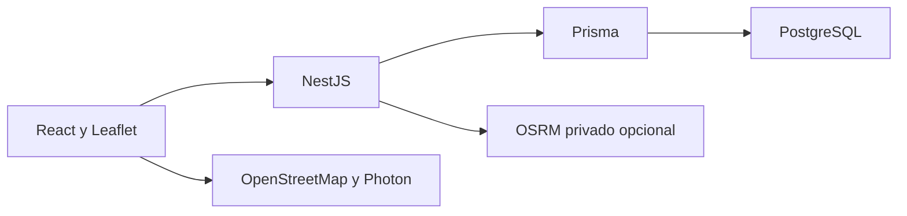

# Arquitectura y funcionalidades comprobadas en código

El sistema organiza pedidos, vehículos y conductores para distribuir entregas. React 19, TypeScript y Vite implementan el cliente; NestJS 11 sirve la API; Prisma 6.12 integra PostgreSQL 16. Leaflet representa mapas y OpenStreetMap aporta cartografía vial. OSRM es un servicio independiente para calcular recorridos.

## Módulos y estado

| Funcionalidad | Referencia desde raíz | Estado y límite |
|---|---|---|
| Autenticación y roles | `src/backend/src/auth`, `users`, `roles` | Implementada; JWT en cookie HttpOnly y autorización backend. La UI no reemplaza los guards. |
| Pedidos | `src/backend/src/orders` | Registro, consulta y estados implementados; revisar los pendientes históricos de filtros y concurrencia antes de afirmar estabilización completa. |
| Vehículos | `src/backend/src/vehicles` | Gestión implementada; permisos propios, no equivalentes a los de planificación. |
| Conductores | `src/backend/src/drivers` | Gestión, cuentas vinculadas y credenciales implementadas. |
| Disponibilidad | `src/backend/src/availability` | Intervalos de conductores implementados; no equivale a asignación de rutas. |
| Planificación | `src/backend/src/planning` | Implementación parcial de la entrega operativa: requiere infraestructura y migración. |
| Consulta de rutas | `src/backend/src/routes` | Lista, detalle e historial en código; validación vial real pendiente. |

`src/backend/src/app.module.ts` compone los módulos y configura validación de entorno y throttling. `src/frontend/src/services` contiene clientes API y `src/frontend/src/features` las pantallas. La sesión usa cookies; recordar el correo no equivale a guardar una contraseña.

## Infraestructura y datos

[Compose](../../docker-compose.yml) define PostgreSQL con volumen persistente y healthcheck, backend y frontend. Los Dockerfiles se construyen desde contexto raíz; las migraciones no se ejecutan en el arranque normal. El [overlay OSRM](../../docker-compose.osrm.yml) necesita un grafo previamente preparado y una imagen seleccionada explícitamente. No se levantaron ni reconstruyeron contenedores en esta revisión.

El [modelo Prisma](../../src/backend/prisma/schema.prisma) y las [migraciones](../../src/backend/prisma/migrations) son la referencia ejecutable. Existen ocho directorios de migración: autenticación, registro de pedidos, ubicación/carga, vehículos/estados, conductores, disponibilidad, planificación y versión de credenciales. Su existencia en Git no prueba aplicación en una base.

El preflight privado de 30/10/2026 04:07 UTC (29/10 23:07 Lima) registra siete migraciones aplicadas y ausencia de la tabla de rutas en public; planificación seguía pendiente. Es una observación histórica, sin nueva consulta de base en esta tarea. No se publica ese JSON porque contiene datos operativos e identidad de usuarios.

## Mapas y cobertura

[Geodata](../../geodata/README.md) documenta Huancayo, Chilca, El Tambo, Huancán y Pilcomayo, EPSG:4326, longitud/latitud. Los ocho hashes y metadatos de la versión se fijan en `geodata/coverage-release.json`; el paquete completo tiene nueve archivos privados. Falta de cobertura verificable devuelve 503 y un punto exterior se rechaza con 400 antes del registro.

Los polígonos INEI son límites administrativos; las teselas OSM son cartografía visual; Photon busca direcciones; OSRM calcula sobre red vial. Ninguno sustituye a los otros. Los permisos de redistribución INEI no están acreditados en la documentación local. Se excluyen los nueve archivos y el ZIP de esta entrega documental.

## Dificultades y soluciones documentadas

El informe 05 de Sprint 3 registra correcciones de Response consumida en mocks, versión cero, draft retenido, geometría corrupta, advertencias históricas e idempotencia/plazos de cálculo. El informe 09 registra actualizaciones compatibles de dependencias y verificaciones históricas, con deuda baja de Jest/deepmerge. Su estado de seguridad debe revalidarse al actualizar dependencias; no se hizo una auditoría npm nueva aquí.
